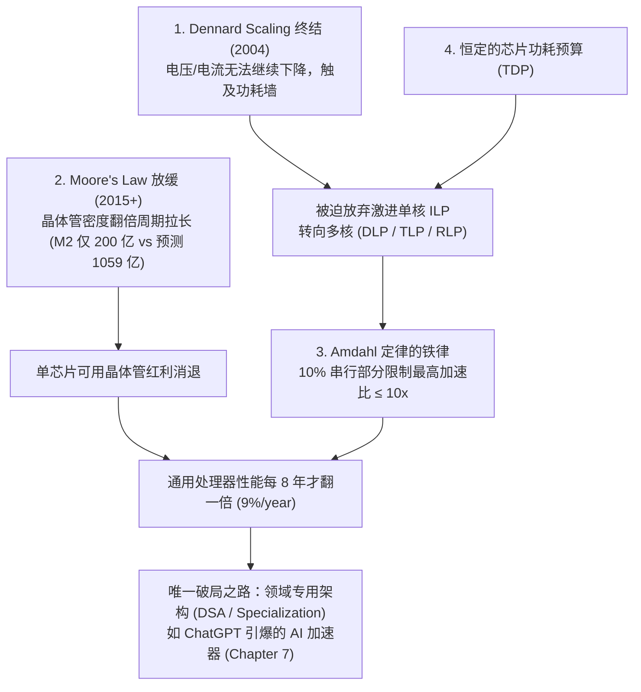
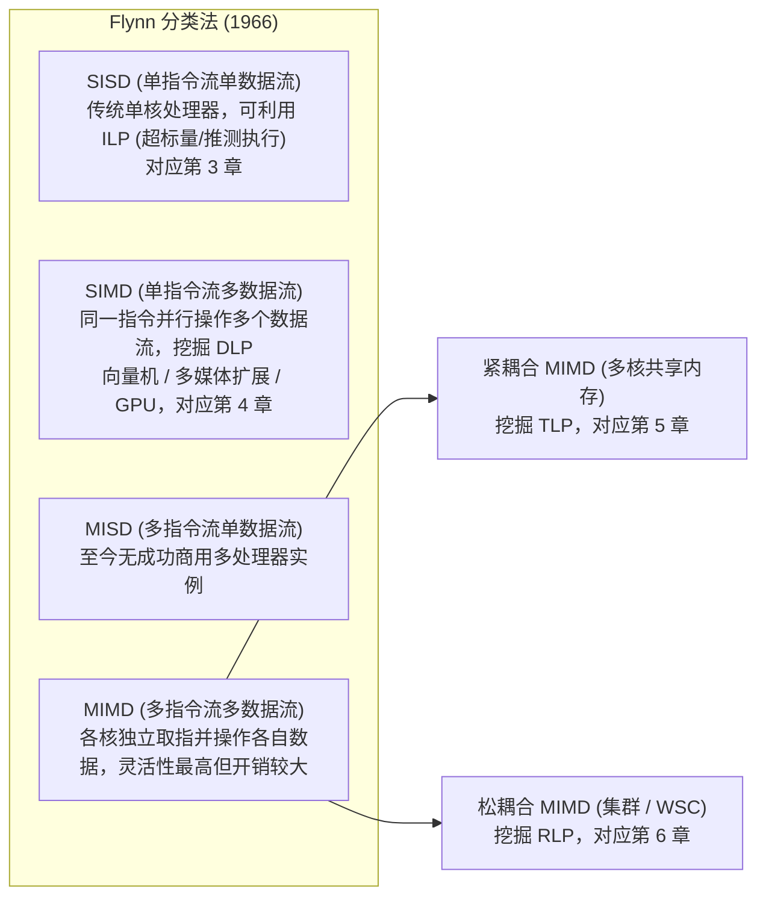
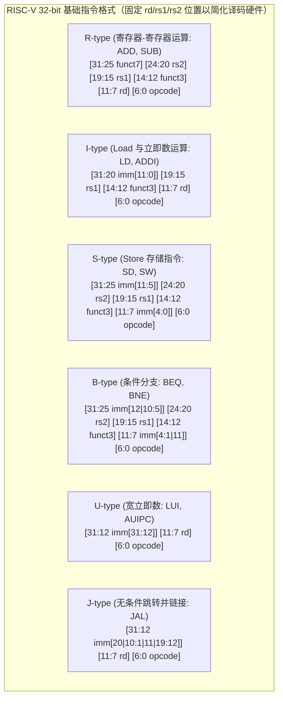
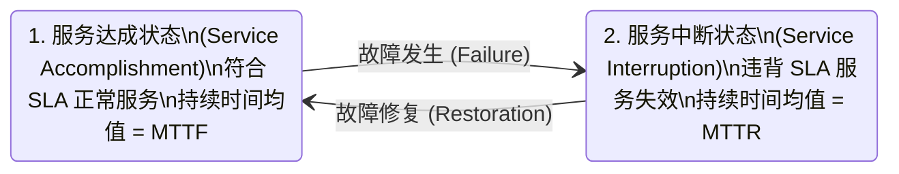
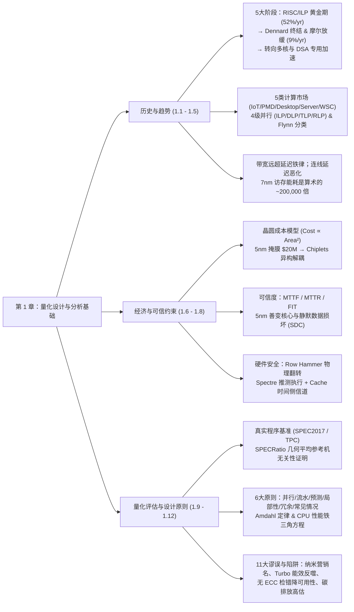

**章节导读**：本文为 John L. Hennessy、David A. Patterson 与 Christos Kozyrakis 合著的计算机体系结构经典名著 **《Computer Architecture: A Quantitative Approach》第七版（7th Edition）** 第一章 *Fundamentals of Quantitative Design and Analysis*（量化设计与分析基础）的详尽精读笔记与深度批注。

第七版不仅引入了新合著者 Christos Kozyrakis，更全面更新了**后摩尔定律时代**的最新行业数据与前沿议题：包括 **ChatGPT 与 AI 专用加速器（DSA）浪潮**、**Chiplets（芯粒）异构集成经济学**、**5nm 及以下工艺的静默数据损坏（Mercurial Cores / Silent Data Corruption）**、**硬件侧信道安全（Row Hammer 与 Spectre）**，以及**数据中心碳足迹（Operational vs. Embodied Carbon）**。

---

## 引言

自第一台通用电子计算机诞生以来的约 75 年间，计算机技术经历了惊人的飞跃：今天一部售价 \$800 的智能手机，其计算性能已经匹敌 2000 年造价超过 \$1 亿美元的全球最快超级计算机。这一跨越主要源于两大驱动力：**制造工艺技术的持续进步**（Technology Advances）与**计算机体系结构设计的创新**（Architectural Innovations）。

### 处理器性能演进的五个历史阶段

书以 **VAX-11/7** 为基准，通过 SPEC 整数基准测试描绘了过去 45 年微处理器性能的演进轨迹。我们可以将其清晰地划分为五个阶段：

| 历史阶段 | 年复合增长率 (CAGR) | 性能翻倍周期 | 备注 |
| :--- | :---: | :---: | :--- |
| **1978 – 1986** | ~25% / 年 | ~3.5 年 | 早期主要依赖集成电路工艺的自然演进与微程序控制结构。 |
| **1986 – 2003** | **~52% / 年** | **~1.5 – 2 年** | **体系结构黄金文艺复兴（Renaissance）**：微处理器崛起 + **RISC 架构**普及，聚焦**指令级并行（ILP，流水线与多发射）**与**多级 Cache 层次结构**。到 2003 年，架构创新带来了相比纯工艺演进（35%/年）高出 **7.5 倍**的额外性能增益。 |
| **2003 – 2011** | ~23% / 年 | ~3.5 年 | **Dennard 缩放定律（Dennard Scaling）终结（约 2004 年）** + ILP 挖掘触及功耗墙，迫使业界放弃高主频单核，全面转向**多核（Multicore）**。 |
| **2011 – 2015** | < 12% / 年 | ~6 年 | 受制于 **Amdahl 定律（Amdahl's Law）** 对显式并行加速比的硬性约束。 |
| **2015 – 2022+** | **~9% / 年** | **~8 年** | **摩尔定律（Moore's Law）显著放缓**，通用处理器单芯片性能进入缓慢爬坡期。 |

/// table-caption
表 1.1 基于 SPECint 基准的处理器性能 45 年演进的五个阶段
///

### 促成 RISC 崛起与黄金时代的市场及技术背景

20 世纪 80 年代初，两项关键的软件生态变革扫清了新指令集架构（ISA）商业化的障碍：

1. **汇编语言编程的近乎消亡**：高级语言与编译器的成熟大幅降低了对二进制目标代码向后兼容（Object-code Compatibility）的绝对依赖。
2. **标准化、跨厂商操作系统的诞生**：如 UNIX 及其开源克隆 Linux，使新架构无需从零构建操作系统生态，极大降低了研发成本与商业风险。

在此背景下，**RISC（精简指令集计算机）** 应运而生，将架构师的精力聚焦于两大核心武器：**指令级并行（ILP）** 与 **高速缓存（Cache）**。面对 RISC 的冲击：

- **DEC VAX** 因无法跟上性能节奏而被淘汰（后被 Alpha 取代）；
- **Intel x86** 迎难而上，在硬件前端将复杂的 80x86 指令**动态翻译为内部类 RISC 的微操作（micro-ops）**，从而成功吸收了 RISC 的流水线与乱序执行创新。在 90 年代末晶体管充裕的 PC/服务器市场，前端翻译的硬件开销微不足道；但在对功耗与硅片面积极其敏感的低端与移动市场（如手机），x86 的翻译开销使其败下阵来，促成了 **ARM** 的统治地位。

### 性能飞跃带来的四大深远影响

1. **计算能力的平民化**：今日的高性能微处理器在众多应用上超越了不到 20 年前的超级计算机。
2. **全新计算形态的诞生**：从 80 年代的 PC 与工作站，到过去 15 年成为主流计算平台的智能手机与平板（PMD），再到背后由 50,000+ 台服务器组成的**仓库级计算机（WSC）**，以及年出货量超百亿的**物联网（IoT）**设备。
3. **微处理器一统江湖**：用分立逻辑或门阵列构建的小型机（Minicomputers）被微处理器服务器取代；甚至大型机（Mainframes）与超级计算机（Supercomputers）也全部演变为微处理器的大规模集群。
4. **以性能换生产力**：让现代程序员得以用运行效率换取开发效率——从注重极致性能的 C/C++，转向托管语言（Java）乃至高生产力脚本语言（Python、JavaScript）与现代框架（Django、AngularJS）；JIT（即时编译）与基于执行轨迹的编译器（Trace-based Compiling）逐步取代传统静态编译链接；软件交付也从本地安装盒装软件转向基于云端的 **SaaS（软件即服务）**（典型案例如实时调用云端 WSC 实现多模态拍照/语音翻译的 Google Translate）。

### 为什么通用处理器黄金时代终结

- **Dennard 缩放定律的终结（2004）**：1974 年 Robert Dennard 指出，随着晶体管尺寸缩小，电压与电流同步降低，**单位硅片面积的功率密度保持恒定**——晶体管变快的同时功耗反而更低。但到 2004 年左右，阈值电压与漏电流限制使得工作电压无法继续下探而不损害电路可靠性。这迫使 Intel 在 2004 年取消高性能单核项目，行业从程序员无感知的**隐式并行（ILP）**，被迫转向需要程序员重构代码的**显式并行（DLP 数据级并行、TLP 线程级并行、RLP 请求级并行）**。
- **摩尔定律的放缓**：Gordon Moore 在 1965 年预测单芯片晶体管数量每年翻倍（1975 年修正为每 2 年翻倍）。这一定律维持了约 50 年后正式失效。例如：2010 年 Intel 最新微处理器拥有 11.7 亿（1.17B）晶体管；若按摩尔定律每 2 年翻倍推算，2022 年应达到 **1059 亿（105.9B）**，而实际上 2022 年的 Apple M2 仅有 **200 亿（20B）** 晶体管，相差逾 **5 倍**。
- **破局的唯一路径——专用化（Specialization / DSA）**：当晶体管不再显著变好、功耗预算恒定、多核受限于 Amdahl 定律时，唯一能大幅改善**能效-性能-成本（Energy-Performance-Cost）**的途径就是**领域专用架构（Domain-Specific Architectures, DSA）**。2023 年 **ChatGPT** 的发布更是极大地加速了从端侧 IoT 到云端 WSC 全面部署 AI 专用加速器的浪潮。

!!! tip "深入理解与思考：从“免费午餐”到软硬协同的黄金时代"
    第 1.1 节浓缩了整个现代计算产业的宏观逻辑。在 1986–2003 年间，体系结构师通过流水线、乱序超标量、分支预测和多级 Cache，把底层硬件的并行性完美封装在串行 ISA 接口之下，造就了软件界的“免费午餐时代”（La-Z-Boy Era）。
    
    然而物理定律（阈值电压 $V_{th}$ 决定的亚阈值漏电与栅氧化层隧穿效应）终结了 Dennard Scaling，光刻物理极限与掩膜成本减缓了 Moore's Law。这意味着**通用指令集架构下的微结构潜能已被榨干**。未来的体系结构不再是“单核微结构的局部修补”，而是**以特定领域计算图（如 GEMM 矩阵乘、Attention 算子）为中心，打破传统冯·诺依曼瓶颈的软硬件协同设计（Co-design）**。这正是 Hennessy 和 Patterson 在图灵奖演讲中称之为“体系结构新黄金时代（A New Golden Age for Computer Architecture）”的真正含义。

---

## 计算机的分类与并行性分类体系

### 五大主流计算市场及其系统特征

随着计算场景的分化，现代计算机形成了五大主流类别（如表 1.2 所示，对应书中 Figure 1.2）：

| 计算机类别 | 系统价格范围 | 微处理器价格 | 关键系统设计目标与约束 | 2021 年市场规模参考 |
| :--- | :--- | :--- | :--- | :--- |
| **物联网 / 嵌入式** *(IoT / Embedded)* | \$0.01 – \$100 | \$0.01 – \$10s | **成本底线优先**：在最低价格下满足特定性能（含硬实时需求）与功耗限制。通常不运行第三方软件。 | 约 300 亿颗嵌入式处理器（预计 2025 年 IoT 达 300–400 亿） |
| **个人移动设备** *(PMD)* | \$100 – \$1,000 | \$10 – \$100 | **能效、成本、响应性与媒体体验**：电池供电 + 塑料封装无风扇散热限制总功耗；强调**软实时（Soft Real-time）**与最小化内存/代码体积（采用 Flash 存储）。可运行第三方软件。 | 约 20 亿台（90% 为手机），年营收约 \$5,000 亿（最大市场） |
| **桌面计算** *(Desktop)* | \$300 – \$2,500 | \$50 – \$500 | **性价比（Price-Performance）** 与图形性能：2021 年约 75% 销量为笔记本电脑。 | 约 3.57 亿台（80% 为笔记本），营收约为手机市场一半 |
| **服务器** *(Servers)* | \$10,000 – \$10,000,000 | \$200 – \$2,000 | **可用性（Availability）**、**可扩展性（Scalability）**、**高吞吐率（Throughput）** 与 **总拥有成本（TCO）**。生命周期长达 5–8 年，CPU 采购价仅占 TCO 的约 1/4。 | 约 1,300 万台 |
| **集群 / 仓库级计算机** *(Clusters / WSCs)* | \$100,000 – \$200,000,000 | \$50 – \$250 | **极致性价比、能耗/散热成本与高可用性**：数万台廉价冗余服务器通过局域网集成为单一巨型计算机，依靠**软件层**屏蔽硬件故障。每座 WSC 年均摊 IT 设备成本约 \$5,000 万。 | 头部云厂商（如 Amazon）拥有超 100 座 WSC |

/// table-caption
表 1.2 五大主流计算市场的系统特征对比（注：2021 年基于 ARM 技术的芯片总出货量达 230 亿颗）
///

!!! info "概念辨析"
    1. **嵌入式与非嵌入式的分界线**：本书以**“是否支持运行外部开发的第三方软件（Third-party Software）”**作为 PMD（非嵌入式）与传统嵌入式设备的分界线。
    2. **实时性（Real-time）与软实时（Soft Real-time）**：硬实时要求任务有绝对的最大执行时间上限；PMD 媒体应用（如视频解码）通常采用**软实时**——约束任务的平均耗时，并允许极少数帧偶尔超时，只要超时次数可控且不影响用户体验。
    3. **WSC 与超级计算机（Supercomputer）的异同**：两者造价均高达数亿美元，但超算强调**浮点峰值性能**、定制的**高带宽低延迟互连网络**以及连续运行数周的**大规模通信密集型批处理科学计算**；而 WSC 强调**交互式响应应用**、海量存储、标准以太网互连、软件容错可用性以及高互联网出口带宽。

### 并行性的两个层面与四大硬件开发方式

在能耗与成本的双重约束下，多层次并行已成为所有计算机类别的核心驱动力：

- **应用层的两种内生并行性**：
  1. **数据级并行（Data-Level Parallelism, DLP）**：存在大量可同时进行相同或独立操作的数据项。
  2. **任务级并行（Task-Level Parallelism, TLP）**：工作负载可被划分为多个能独立、基本并行执行的任务。

- **硬件层挖掘应用并行性的四种主流途径**：
  1. **指令级并行（ILP）**：在编译器协助下，通过流水线（Pipelining）和乱序推测执行（Speculative Execution）在中低尺度上隐式挖掘 DLP。
  2. **向量架构、GPU 与多媒体指令集扩展**：通过将单条指令并行作用于一组数据集合，高效挖掘 DLP。
  3. **线程级并行（Thread-Level Parallelism, TLP）**：在紧耦合（Tightly Coupled）多核硬件模型中，通过允许交互的并行线程挖掘 DLP 或任务级并行。
  4. **请求级并行（Request-Level Parallelism, RLP）**：在松耦合（Loosely Coupled）系统中，挖掘由程序员或操作系统指定的、高度解耦的独立任务间的并行性（如 WSC 处理海量并发用户请求）。

### Flynn 分类法（Flynn's Taxonomy, 1966）

Michael Flynn 根据指令流（Instruction Stream）和数据流（Data Stream）的单复数关系，将计算机划分为四类：

---

## 定义计算机体系结构：从“短视的 ISA 观”到“真正的体系结构”

过去，“计算机体系结构”常被狭隘地等同于“指令集设计”，而将其余部分贬低为“缺乏挑战的硬件实现（Implementation）”。作者明确批判了这种短视观点：**真正的计算机体系结构（Genuine Computer Architecture）涵盖指令集架构（ISA）、微架构/组织（Organization / Microarchitecture）与硬件实现（Hardware）三个不可分割的维度**。

### x86、ARMv8 与 RISC-V 对比

ISA 是软硬件之间的核心契约界面。第七版以免费开源、设计优雅的 **RISC-V（RV64I/RVF/RVD）** 作为全书的核心教学 ISA（2024 年 RISC-V SoC 出货量已达 20 亿颗，预计 2031 年将达每年 300 亿颗；而 ARM 在 2023 年出货达 300 亿颗，是 x86 的 100 倍以上）。ISA 的设计可拆解为以下 **7 个正交维度**：

| 维度 | 核心设计选项 | 80x86 (CISC 代表) | ARMv8 (商用 RISC 代表) | RISC-V (开源现代 RISC 代表) |
| :--- | :--- | :--- | :--- | :--- |
| **ISA 类别** | 寄存器-内存 (Register-Memory) vs. 载入-存储 (Load-Store) | **Register-Memory**：许多运算指令可直接访问内存；16 个通用寄存器 + 16 个浮点寄存器 | **Load-Store**：仅通过 Load/Store 访存（1985 年后新发布的 ISA 全部为 Load-Store） | **Load-Store**：32 个通用整数寄存器（`x0`–`x31`，其中 `x0` 恒为 0）+ 32 个浮点寄存器（`f0`–`f31`） |
| **内存编址** | 字节编址与对齐要求 ($A \bmod s = 0$) | 字节编址，**不强制对齐**（但对齐访问更快） | 字节编址，部分指令要求对齐 | 字节编址，**不强制对齐**（对齐访问更快） |
| **寻址模式** | 指定寄存器、立即数与内存有效地址的方式 | 寄存器、立即数、偏移量，以及无基址绝对寻址、双寄存器基址变址、带比例因子变址等多种复杂模式 | 包含 RISC-V 三种模式 + PC 相对、双寄存器求和（含比例因子）、自动递增/递减（Auto-inc/dec） | **极简 3 种**：寄存器（Register）、立即数（Immediate）、偏移量（Displacement，寄存器 + 常数偏移） |
| **操作数类型与大小** | 整数与浮点格式支持 | 8/16/32/64-bit 整数，IEEE 754 32/64-bit 浮点 + **80-bit 扩展双精度浮点** | 8/16/32/64-bit 整数，IEEE 754 32/64-bit 浮点（AI 驱动下新增 FP16/BF16 等） | 8-bit (ASCII)、16-bit (Half word)、32-bit (Word)、64-bit (Double word)，IEEE 754 单/双精度及 AI 半精度扩展 |
| **操作类型** | 数据传送、算术逻辑、控制、浮点 | 极其庞大复杂（见附录 K） | 精简规整 | 基础整数集（RV64I）+ 乘除扩展（RVM）+ 单/双精度浮点扩展（RVF/RVD） |
| **控制流指令** | 条件分支、跳转、过程调用与返回（均采用 PC 相对寻址） | **条件码（Condition Codes）**测试；`CALLF` 将返回地址**压入内存栈** | **条件码**测试；过程调用将返回地址存入**寄存器** | **直接比较寄存器内容**（`BEQ`, `BNE`, `BLT` 等，无条件码副作用）；返回地址存入**寄存器**（`JAL`/`JALR`） |
| **指令编码** | 定长编码 vs. 变长编码 | **变长编码（1–18 字节）**：代码体积通常比定长 RISC 小，但译码复杂 | **32-bit 定长编码**（ARMv7 有 Thumb-2 16/32-bit 混合扩展） | **32-bit 定长编码**（共 R/I/S/B/U/J 六种规整格式，源/目的寄存器字段位置固定；另有 RV64IC 16/32-bit 压缩扩展，代码密度甚至优于 x86） |

/// table-caption
表 1.3 ISA 七大维度在 x86、ARMv8 与 RISC-V 中的设计抉择对比
///

### 真正的体系结构：组织（微架构）与硬件实现

1. **组织 / 微架构（Organization / Microarchitecture）**：指计算机设计的高层结构，如内存系统、内存互连、CPU 内部流水线与 Cache 组织。例如 **AMD EPYC** 与 **Intel Xeon** 拥有相同的 x86 ISA，但微架构组织截然不同。（注：多核普及后，“CPU”常被用来指代微处理器中的单个“核心 Core”）。
2. **硬件（Hardware）**：指具体的逻辑设计、电路实现与封装工艺。例如 **Intel Core i7** 与 **Intel Xeon E7** 具有相同的 ISA 和高度相似的微架构，但硬件实现提供了不同的主频、内存通道与多路互连设计，使 Xeon 更适合服务器场景。

---

## 技术趋势：五大核心技术与“延迟滞后于带宽”定律

成功的体系结构必须经受住底层技术剧变的考验（例如 IBM 大型机核心架构延续了 60 年）。架构师必须密切追踪以下 **5 项关键实现技术**的演进趋势：

1. **集成电路逻辑技术（IC Logic）**：历史上晶体管密度每年增长约 35%（4 年翻四倍），加上芯片面积（Die size）每年 10%–20% 的增长，共同构成了每年 40%–55% 的晶体管数量增长（摩尔定律）。如今摩尔定律正在减速，每一代新工艺的翻倍时间不断拉长。
2. **半导体 DRAM（动态随机存取存储器）**：主存的基石。过去每 3 年容量翻四倍（Quadrupling）的黄金规律已彻底终结——**8 Gb DRAM 于 2014 年量产，16 Gb 直到 2019 年才问世，2023 年推出了历史上首个非 2 的幂次容量的 24 Gb DRAM**，下一代目标为 32 Gb。这意味着 DRAM 容量翻四倍（从 8 Gb 到 32 Gb）至少需要 **10 年**！且目前看不到任何能真正替代 DRAM 的新介质。
3. **半导体 Flash（闪存）**：PMD 的标配非易失性存储，在 2024 年服务器市场中基于 Flash 的 SSD 销量已占磁盘总销量的一半以上。Flash 容量每年增长约 50%–60%（约 3 年翻倍），每比特成本比 DRAM 便宜 **8–10 倍**，未来主要依靠 **3D 堆叠层数增加**与单元微缩继续扩容。
4. **磁盘技术（Magnetic Disk）**：面密度（Areal Density）增速从 1996 年的 100%/年暴跌至过去十年的 **不足 5%/年**（翻倍需 15–20 年）。目前 3.5 英寸 1 英寸厚的硬盘内已塞入 10 张盘片（Platters），容量提升主要靠增加盘片数。但机械硬盘每比特成本仍比 Flash 便宜 **3–5 倍**，比 DRAM 便宜 **100–200 倍**，在 WSC 冷数据存储中仍不可替代。
5. **网络技术（Network）**：取决于交换机与传输系统，以太网已从 10 Mbps 演进至 400 Gbps / 800 Gbps。

!!! note "技术阈值效应（Technology Thresholds）"
    技术演进往往是连续的，但对体系结构的影响却是**阶跃式（Discrete Leaps）**的。例如 80 年代初单芯片容纳 25,000–50,000 晶体管时，单芯片 32 位微处理器才成为可能；80 年代末跨过新阈值后，L1 Cache 得以集成到片上，随后是 L2、L3 Cache 片上化。消除跨芯片通信（Chip Crossings）带来了性价比和能效的质变。

### 性能趋势铁律：带宽远超延迟（Bandwidth Outpaces Latency）

对比微处理器、内存、网络、磁盘在过去 25–45 年间的里程碑数据（Figure 1.9 & 1.10）：

- **微处理器与网络**（以性能为核心卖点）：带宽提升了 **45,000 – 80,000 倍**，而延迟仅改善了 **50 – 90 倍**。
- **内存与磁盘**（以容量为核心卖点）：带宽提升了 **450 – 4,000 倍**，而延迟仅改善了 **5 – 9 倍**！（甚至由于 2021 年大容量硬盘从 15,000 RPM 退回 7,200 RPM，以及处理器基础主频回调，磁盘和 CPU 的绝对延迟在近 5 年反而有所增加）。

**原因与启示**：改善带宽只需复制硬件通道、加宽总线或加深流水线并发；而降低延迟受制于物理光速、电容充放电与机械物理极限。架构师必须顺应“高带宽、高延迟”的现实，通过**预取、流水线、多线程与批处理**来掩盖延迟。

### 晶体管性能与片上连线延迟（Wire Delay）的背离

- **特征尺寸（Feature Size）与二次方红利**：从 1971 年的 $10\ \mu\text{m}$ 缩至 2022 年的 $7\ \text{nm}$ 乃至 $3\ \text{nm}$、Intel 规划的 $18\ \text{\AA}$（$1.8\ \text{nm}$）。由于晶体管面积按二维缩小，**单位面积晶体管密度随特征尺寸线性缩小而呈平方级（Quadratically）增长**，而晶体管开关速度历史上仅呈**线性（Linearly）**提升。
- **连线延迟（Wire Delay）恶化**：信号在导线上的传播延迟正比于电阻与电容的乘积（$R \times C$）。当特征尺寸微缩时，虽然导线变短，但导线截面积变小、间距变窄导致**单位长度的电阻和电容反而恶化**。如今在大规模芯片中，连线延迟往往比晶体管门延迟更致命，消耗了时钟周期的很大一部分。

---

## 集成电路中的功耗与能耗趋势

今天，**能量（Energy）与功耗（Power）** 是几乎所有类型计算机面临的最大设计挑战。

### 系统视角的三个核心指标：峰值功耗、TDP 与任务能耗

1. **最大功耗（Maximum Power）**：决定供电系统（Power Supply）与电压调节模块的设计上限。若瞬时电流超限会导致电压跌落（Voltage Drop）引发电路故障。
2. **热设计功耗（Thermal Design Power, TDP / 持续功耗）**：决定**散热系统（Cooling System）**的设计规格。TDP 既不是峰值功耗（峰值通常比 TDP 高 1.5 倍），也不是实际运行时的平均功耗（通常低于 TDP）。现代 CPU 提供两道热保护机制：① 接近结温上限时自动降低时钟频率；② 若温度继续失控，触发热过载陷阱（Thermal Overload Trap）直接断电关机。
3. **能量与能效（Energy and Energy Efficiency）——比较处理器的唯一正确指标**：
   功率只是单位时间的能量（$1\ \text{W} = 1\ \text{J/s}$），而完成一项特定工作负载的总能量为：

$$
\text{Energy} = \text{Average Power} \times \text{Execution Time}
$$

!!! warning "为什么必须用 Energy（焦耳）而非 Power（瓦特）来对比处理器？"
    对于固定任务，单纯降低时钟频率可以降低功率（Power），但执行时间会成比例拉长，因此总耗能（Energy）不变甚至因为静态漏电而增加！
    
    **书中的经典算例**：假设处理器 A 的平均功率比处理器 B 高 20%（$1.2\times$），但 A 完成任务的时间仅为 B 的 70%（$0.7\times$），则 A 消耗的总能量为 $1.2 \times 0.7 = 0.84$（比 B 省电 16%）。无论对于手机电池续航还是云数据中心的电费账单，**完成特定任务的能量（Tasks per Joule）** 才是真正的黄金评估指标，而功率（Power）主要作为散热约束（如风冷上限约 300 W，近年 Intel/NVIDIA 接近 1000 W TDP 的芯片已必须采用液冷）。

### 微处理器内部的动态能耗与静态功耗方程

在 CMOS 电路中，功耗由**动态功耗（Dynamic Power，晶体管翻转充放电）**与**静态功耗（Static Power，晶体管关闭时的漏电流）**两部分组成：

- **单次完整逻辑脉冲（$0 \to 1 \to 0$ 或 $1 \to 0 \to 1$）的动态能量**：

$$
\text{Energy}_{\text{dynamic}} \propto \text{Capacitive load} \times \text{Voltage}^2
$$

- **单次逻辑翻转（$0 \to 1$ 或 $1 \to 0$）的动态能量**：

$$
\text{Energy}_{\text{dynamic}} \propto \frac{1}{2} \times \text{Capacitive load} \times \text{Voltage}^2
$$

- **每个晶体管的动态功率（Dynamic Power）**：

$$
\text{Power}_{\text{dynamic}} \propto \frac{1}{2} \times \text{Capacitive load} \times \text{Voltage}^2 \times \text{Frequency switched}
$$

- **静态功率（Static Power / Leakage Power）**：

$$
\text{Power}_{\text{static}} \propto \text{Current}_{\text{static}} \times \text{Voltage}
$$

静态功率正比于晶体管数量，在高性能芯片（含大容量 SRAM Cache）中，漏电功耗占比高达 **25% 甚至 50%**！唯一彻底消除漏电的方法是对闲置模块实施**电源门控（Power Gating，切断电源供应）**。

#### 例题精析：调压调频对能量与功率的影响

> **题目**：现代微处理器支持动态调压，假设将工作电压降低 15%，同时导致时钟频率降低 15%，求对动态能量（Dynamic Energy）和动态功率（Dynamic Power）的影响？
>
> **解答**：电容负载 $C$ 不变。动态能量仅与电压平方成正比：
>
> $$
> \frac{\text{Energy}_{\text{new}}}{\text{Energy}_{\text{old}}} = \frac{(\text{Voltage} \times 0.85)^2}{\text{Voltage}^2} = 0.85^2 \approx 0.72
> $$
>
> 即动态能量降至原来的 **72%**。而动态功率还要乘以频率缩放比：
>
> $$
> \frac{\text{Power}_{\text{new}}}{\text{Power}_{\text{old}}} = 0.72 \times \frac{\text{Frequency} \times 0.85}{\text{Frequency}} = 0.85^3 \approx 0.61
> $$
>
> 动态功率大幅降至原来的 **61%**！这正是 DVFS 技术的数学根基。

### 应对主频停滞与功耗墙的五大微架构技术 + Race-to-Halt

自 2003 年以来，微处理器基础时钟频率几乎停滞（维持在 3 GHz 左右，见 Figure 1.11）。现代处理器采用以下技术提升能效：

1. **把“无所事事”做好（Do nothing well / 时钟门控 Clock Gating）**：关闭当前未激活模块（如未执行浮点指令时的 FPU、空闲的核心）的时钟树，消除动态翻转功耗。
2. **动态电压频率调整（DVFS）**：在低负载时段同时降低工作电压与频率（如服务器在 2.4 GHz / 1.8 GHz / 1.0 GHz 三档切换，每档可节省全机 10%–15% 功耗）。
3. **为常见情况设计（Design for the common case）**：DRAM 与磁盘提供多级低功耗休眠模式；PC 处理器按典型负载设计散热，依赖片上温度传感器在极端负载下触发“紧急降频（Emergency Slowdown）”。
4. **动态超频（Overclocking / Turbo Mode）**：2008 年起 Intel 引入 Turbo 模式，在散热余量允许时关闭部分空闲核心，让少数活跃核心短时运行在远高于标称主频的频率下（如 Xeon E-2378G 标称 2.8 GHz，Turbo 可达 5.1 GHz，增幅达 30%–80%）。注意：Turbo 频率受环境室温影响，会导致程序性能出现非确定性波动！
5. **异构多核（Heterogeneous Cores）**：如 iPhone 14 Pro 搭载 2 个高性能大核 + 4 个高能效小核（大小核架构），并配合窄领域的专用加速器。
6. **全速冲刺后休眠（Race-to-halt）**：由于 CPU 只是整机功耗的一部分（主板、内存、屏幕等都在耗电），有时使用更快但能效稍差的处理器迅速跑完任务，让整个系统尽早进入深度睡眠（Sleep Mode），全系统总能耗反而更低。

### 暗硅时代（Dark Silicon）与算子/访存的真实能耗鸿沟

在固定功耗预算下，现代芯片上的晶体管数量已经多到**无法在同一时刻全部点亮**，大部分硅片区域在任意时刻必须保持关闭（即 **Dark Silicon，暗硅现象**）。

第七版 Figure 1.13（源自 Jouppi et al., 2021）给出了 **TSMC 7nm 工艺节点**下各类算术运算与存储访问的绝对能量成本（pJ）与相对倍数，这是理解现代 AI 芯片（如 TPU、GPU Tensor Core）设计哲学的**最关键数据表**：

| 操作类型 (TSMC 7nm) | 能量消耗 (pJ) | 相对 8-bit 整数加法的能量倍数 | 架构设计核心启示 |
| :--- | :---: | :---: | :--- |
| `Int 8` 加法 (Add) | $0.007\ \text{pJ}$ | **$1\times$ (基准)** | 极低能耗，量化推理的基石 |
| `Int 32` 加法 (Add) | $0.030\ \text{pJ}$ | $4\times$ | 位宽增加 4 倍，加法能耗增加约 4 倍 |
| `BFloat 16` 加法 / `IEEE FP16` 加法 | $0.110\ \text{pJ}$ / $0.160\ \text{pJ}$ | $16\times$ / $23\times$ | BF16 指数位与 FP32 相同但尾数更短，硬件更省电 |
| `IEEE FP32` 加法 (Add) | $0.380\ \text{pJ}$ | **$54\times$** | 32 位浮点加法能耗是 8 位整数加法的 **54 倍**！ |
| `Int 8` 乘法 (Multiply) | $0.070\ \text{pJ}$ | $10\times$ | 低比特乘法依然极其廉价 |
| `BFloat 16` 乘法 / `IEEE FP16` 乘法 | $0.210\ \text{pJ}$ / $0.340\ \text{pJ}$ | $30\times$ / $49\times$ | AI 训练/推理主力算子，能耗仅为 FP32 乘法的 1/6 ~ 1/4 |
| `IEEE FP32` 乘法 / `Int 32` 乘法 | $1.310\ \text{pJ}$ / $1.480\ \text{pJ}$ | $187\times$ / $211\times$ | 二次方复杂度使宽位宽乘法器耗能显著 |
| **32b 读取 8 KB SRAM** | $7.500\ \text{pJ}$ | **$1,071\times$** | 哪怕访问极小的片上 L1 SRAM，能耗也是 Int8 加法的上千倍 |
| **32b 读取 1 MB SRAM** | $14.000\ \text{pJ}$ | **$2,000\times$** | 大容量片上缓存访问代价翻倍 |
| **32b 读取 DDR4 DRAM** | **$1,300.000\ \text{pJ}$** | **$185,714\times$ ($\approx 200,000\times$)** | **惊人的访存墙：一次 32 位片外 DRAM 访问消耗的能量相当于近 20 万次 Int8 加法！小型片上 SRAM 比 DRAM 节能约 175 倍。** |

/// table-caption
表 1.4 TSMC 7nm 工艺下基本算术运算与存储访问的能量成本对比（Figure 1.13）
///

**为什么领域专用架构（DSA）能获得数量级的能效提升？**
从表 1.4 一目了然：DSA（如 Google TPU）通过**将高精度宽浮点（FP32）降维至低精度格式（BF16 / FP16 / Int8）**，并**采用专用片上缓冲区（Scratchpad / 脉动阵列寄存器数据复用）最大限度减少片外 DRAM 访问**，省下了海量的能量与面积，从而可以在芯片上塞入比通用 CPU 多 **10 到 1000 倍**的窄位宽算术单元！

### 计算能耗对全球气候变化的影响

信息技术碳排放分为两类：

1. **运行碳排放（Operational Emissions）**：硬件运行及数据中心供电冷却消耗的电能。
   - 运行能耗：$\text{Energy} = \text{Execution time} \times \text{Number of computers} \times \text{Average power per computer}$（数据中心还需乘以供电冷却开销因子 PUE）。
   - 碳排放当量：$\text{CO}_2\text{e} = \text{Energy (kWh)} \times \text{CO}_2\text{e per kWh}$。其中单位千瓦时的碳排放因子因地区电网能源结构不同而相差 **5–10 倍**（例如 2020 年 Google 新加坡数据中心无碳能源占比仅 4%，而芬兰高达 94%，美国爱荷华州因风能充沛达 93%）。
2. **隐含碳排放（Embodied Emissions）**：从硅片提纯、芯片制造到数据中心基建全产业链递归累积的制造期碳排放。随着设备能效提升与清洁能源普及，隐含碳在全生命周期碳足迹中的占比日益凸显。

---

## 成本趋势：晶圆良率模型、NRE 掩膜危机与 Chiplets 革命

优秀的计算机架构师不能做“不知道钢筋混凝土价格的摩天大楼设计师”。在成本敏感的市场（特别是依赖 SoC 的 PMD 与大规模采购的 WSC）中，深刻理解集成电路成本结构是做出架构取舍的前提。

### 时间、产量（Volume）与商品化（Commoditization）

1. **学习曲线（Learning Curve）**：即便制造工艺不变，随着生产经验积累，**良率（Yield，通过测试的合格品百分比）**不断提升，制造成本随时间持续下降。**良率翻倍，则单颗成本减半。**
2. **产量（Volume）**：高产量不仅加速走完学习曲线、提升采购与制造效率（经验法则：**产量每翻一倍，成本下降约 10%**），还能大幅摊薄每台设备分担的研发固定成本（NRE）。
3. **大宗商品化（Commoditization）**：当多厂商大批量销售近乎一致的标准件（如 DRAM、Flash、PC 主板）时，激烈竞争会同时压低制造成本与毛利率（普通 PC 厂商仅能将收入的 **4%** 投入研发 R&D，而高端服务器厂商可达 **12%**）。

### 集成电路成本的三大核心公式（必考定量模型）

一颗封装测试完毕的集成电路总成本为：

$$
\text{Cost of integrated circuit} = \frac{\text{Cost of die} + \text{Cost of testing die} + \text{Cost of packaging and final test}}{\text{Final test yield}}
$$

其中最核心、对架构师设计决策最敏感的是**裸片成本（Cost of die）**：

#### 单个裸片成本公式

$$
\text{Cost of die} = \frac{\text{Cost of wafer}}{\text{Dies per wafer} \times \text{Die yield}}
$$

#### 每晶圆切割裸片数（Dies per wafer）

圆形晶圆切割矩形裸片时，边缘存在“圆孔塞方钉（Square peg in a round hole）”的废料损失。精确估算公式为**晶圆总面积除以裸片面积，再减去晶圆周长除以正方形裸片对角线长度**：

$$
\text{Dies per wafer} = \frac{\pi \times (\text{Wafer diameter} / 2)^2}{\text{Die area}} - \frac{\pi \times \text{Wafer diameter}}{\sqrt{2 \times \text{Die area}}}
$$

#### 晶圆裸片良率模型（Bose-Einstein 经验公式）

假设制造缺陷在晶圆上随机分布，且良率与工艺复杂度因子 $N$（Process-complexity factor）负相关：

$$
\text{Die yield} = \text{Wafer yield} \times \frac{1}{(1 + \text{Defects per unit area} \times \text{Die area})^N}
$$

- **第七版最新工艺参数（2022 年基准）**：
  - 晶圆良率 $\text{Wafer yield}$ 通常假设为 $100\%$。
  - 单位面积缺陷密度 $\text{Defects per unit area}$：在 7nm 和 5nm 工艺下典型值为 **$0.012\ \text{defects/cm}^2$**（即 $0.075\ \text{defects/inch}^2$）。
  - 工艺复杂度因子 $N$：**7nm 工艺为 $N = 33$，5nm 工艺高达 $N = 35$**！
  - 300 mm（12 英寸）加工晶圆成本：**7nm 约为 \$10,000，5nm 约为 \$16,000**（相比第六版 28nm 的 \$4,000–\$5,000 暴涨了约 4 倍）。
  - 光刻掩膜曝光面积上限（**Reticle Limit，光罩极限**）：约为 **$8.5\ \text{cm}^2$（$850\ \text{mm}^2$）**。

#### 例题精析：裸片面积对良率与成本的平方级放大效应

> **题目**：在直径 $300\ \text{mm}$（$30\ \text{cm}$）的 5nm 晶圆（晶圆成本 \$16,000，缺陷密度 $0.012/\text{cm}^2$，$N=35$）上，分别对比边长 $1.5\ \text{cm}$（面积 $2.25\ \text{cm}^2$）与边长 $1.0\ \text{cm}$（面积 $1.00\ \text{cm}^2$）两种裸片的切割数、良率、合格裸片数及单颗成本。
>
> **解答**：
> 1. **计算每晶圆最大裸片数（Dies per wafer）**：
>    - 大裸片（$2.25\ \text{cm}^2$）：
>
>      $\text{Dies per wafer} = \frac{\pi \times 15^2}{2.25} - \frac{\pi \times 30}{\sqrt{2 \times 2.25}} = \frac{706.9}{2.25} - \frac{94.2}{2.12} \approx 270$
>
>    - 小裸片（$1.00\ \text{cm}^2$）：
>
>      $\text{Dies per wafer} = \frac{\pi \times 15^2}{1.00} - \frac{\pi \times 30}{\sqrt{2 \times 1.00}} = \frac{706.9}{1.00} - \frac{94.2}{1.41} \approx 640$
>
>      *(注：面积差 2.25 倍，由于边缘效应，切割总数之比为 $640 / 270 = 2.37$ 倍)*。
> 2. **计算良率（Die yield）与合格裸片数（Good dies）**：
>    - 大裸片（$2.25\ \text{cm}^2$）：
>
>      $\text{Die yield} = \frac{1}{(1 + 0.012 \times 2.25)^{35}} \approx 0.40 \quad \Rightarrow \quad \text{Good dies} = 0.40 \times 270 \approx 109$
>
>    - 小裸片（$1.00\ \text{cm}^2$）：
>
>      $\text{Die yield} = \frac{1}{(1 + 0.012 \times 1.00)^{35}} \approx 0.67 \quad \Rightarrow \quad \text{Good dies} = 0.67 \times 640 \approx 427$
>
> 3. **计算单颗裸片成本（Cost of die）**：
>    - 大裸片：$\$16,000 / 109 \approx \mathbf{\$135}$（按书中和约数）
>    - 小裸片：$\$16,000 / 427 \approx \mathbf{\$35}$
>
> **核心结论**：大裸片面积仅比小裸片大 **2.25 倍**，但每片晶圆产出的合格芯片数少了近 **4 倍**（109 vs. 427），单颗成本也是小裸片的近 **4 倍**！**在工程实践中，单颗合格裸片的成本大致随裸片面积的平方（$\text{Die Area}^2$）增长！**
>
> *(注：为了提升良率，DRAM、处理器大容量 SRAM Cache 以及 GPU 普遍采用**硬件冗余 Redundancy**——如 ~100 个流处理器的 GPU 预留 4 个冗余核心，容忍局部制造缺陷；同时，提升晶圆良率也是降低单颗芯片**隐含碳排放 Embodied Carbon** 的最有效手段。)*

### NRE 掩膜成本危机与 Chiplets（芯粒）异构集成（第七版重点更新）

除了可变制造成本，先进工艺节点的**一次性工程研发费用（NRE, Nonrecurring Engineering Costs）**与**光罩掩膜成本（Mask Costs）**正在急剧飙升：

- **掩膜成本暴涨 13 倍**：28nm 工艺掩膜成本约为 \$150 万；到了 **7nm 升至 \$1,000 万，5nm 高达 \$2,000 万**！加上 IP 验证、架构设计、验证（Verification）、物理版图、底层软件与系统确认（Validation），5nm 商业芯片总 NRE 动辄数亿美元（Figure 1.17）。（小微团队只能通过台积电 **MPW 穿梭流片 Shuttle Runs** 分摊掩膜，如 2022 年 \$12,000 可拿 80–100 颗 $1 \times 1\ \text{mm}$ 的 28nm 裸片）。
- **核心矛盾**：一方面，体系结构趋势要求针对不同领域设计大量低出货量的**专用芯片（DSA）**；另一方面，半导体经济学却要求必须有千万级超高出货量才能摊薄天价掩膜成本。同时，**SRAM 密度微缩与模拟/I/O 电路微缩严重掉队**（Figure 1.18 显示，相比理想缩放，SRAM 在 7nm 落后 $5\times$、5nm 落后 $8\times$、3nm 落后高达 **$18\times \sim 20\times$**；I/O 在 7nm 之后几乎不再受益于先进工艺）。

**破局之道：Chiplets（芯粒）封装架构**
与其制造一颗接近光罩极限的巨型单芯片（Monolithic Die），不如将系统拆分为多个面积更小的 **Chiplets（芯粒）**，甚至将无需先进工艺的模块（如 I/O、内存控制器）留在廉价成熟工艺，再通过先进封装集成为一个 **Socket（插槽级芯片）**：

| 维度 | 传统单一大芯片 (Monolithic Die) | Chiplets 异构芯粒架构（以 AMD EPYC 为例） |
| :--- | :--- | :--- |
| **第一代 EPYC (14nm, 32核)** | 单芯片需 $777\ \text{mm}^2$，良率极低 | 拆为 **4 颗 $213\ \text{mm}^2$ 的 Chiplet**（总面积 $852\ \text{mm}^2$，虽增加 10% 面积，但算上良率后**总成本降低 $1.7\times$**），且一套裸片设计可灵活派生 16 核与 32 核产品。 |
| **第二代 EPYC Rome (7nm+12nm, 64核)** | 若单芯片制造将超过 $1000\ \text{mm}^2$，**超出 $850\ \text{mm}^2$ 光罩极限，根本无法制造！** | **异构工艺解耦**：将不随 7nm 改善的 I/O 整合为 1 颗 **12nm 廉价工艺的 I/O Die（$416\ \text{mm}^2$）**，计算核心拆为多颗 **7nm 的 8 核 CCD（仅 $74\ \text{mm}^2$）**。一套设计衍生出 16/24/48/64 核全产品线，16–48 核成本比单芯片低 **$1.8\times \sim 2\times$**。 |
| **新挑战** | 片内连线延迟低、带宽高 | 需设计跨芯粒互连（延迟/功耗略高、带宽较低）、部分逻辑需重复配置；目前多为厂商专有（Bespoke Chiplets），行业正致力于推进类似 70 年代 TI 74 系列 TTL 芯片的**通用芯粒标准（Universal Chiplet Standard，如 UCIe）**。 |

/// table-caption
表 1.5 单芯片与 Chiplets 架构的工程经济学对比
///

### 资本支出（CAPEX）与运营支出（OPEX）

在仓库级计算机（WSC）中，**总拥有成本（TCO）** 等于购买硬件的**资本支出（CAPEX）**加上运行生命周期（通常 3–4 年，摩尔定律放缓后部分企业延长至 6–8 年）内的**运营支出（OPEX）**：

- 服务器与网络设备的分摊采购价仅占 WSC 月度总成本的约 **50%**；
- 运营成本中约 **40%** 来自**电费以及供电、散热基础设施的分摊成本**（尽管供电散热基建按 10–15 年摊销）。因此，提升能效就是直接削减 WSC 的 OPEX。

---

## 可靠性与可信度（Dependability）

### 5nm 及以下的新危机：善变核心（Mercurial Cores）与静默数据损坏（SDC）

历史上，芯片内部逻辑电路极少出错，故障多发生在引脚、互连或受宇宙射线干扰的存储单元（可用奇偶校验 Parity 或纠错码 ECC 保护）。但第七版特别指出：**在 5nm 及更小工艺节点下，芯片内部组合/时序运算逻辑的瞬态故障（Transient Faults）与永久故障（Permanent Faults）正变得越来越频繁！**

Google 和 Meta（Facebook）的研究人员在每千台数据中心服务器中发现了数颗被称为 **“善变核心（Mercurial Cores）”** 的缺陷核心，导致严重的**静默数据损坏（Silent Data Errors / Silent Corrupt Execution Errors, SDC）**：

1. 发生频率远超程序员预期，且绝非背景辐射错误率的温和增加；
2. 发生在**缺乏 ECC 保护的算术逻辑功能单元内部**，只能通过比对计算结果与预期值才能抓出；
3. 具有潜伏性：可能在硬件上架运行很久之后才突然出现，或因软件微小更新更密集地调用了某条平时罕用的指令而突然触发；
4. 通常只影响多核芯片中的**某一个特定核心**，而非整颗芯片。

### 可信度（Dependability）的量化指标体系：SLA、MTTF、MTTR、MTBF 与 FIT

围绕服务等级协议（**SLA / SLO**），系统在两个状态间交替：

由此严格定义可靠性（Reliability）与可用性（Availability）的量化公式：

- **平均无故障时间（MTTF, Mean Time To Failure）**：衡量模块可靠性的核心指标。
- **平均修复时间（MTTR, Mean Time To Repair）**：衡量服务中断的平均耗时。
- **平均故障间隔时间（MTBF, Mean Time Between Failures）**：

$$
\text{MTBF} = \text{MTTF} + \text{MTTR}
$$

- **模块可用性（Module Availability）**：

$$
\text{Module availability} = \frac{\text{MTTF}}{\text{MTTF} + \text{MTTR}} = \frac{\text{MTTF}}{\text{MTBF}}
$$

- **年故障率（AFR, Annual Failure Rate）与 FIT（Failures In Time）**：
  故障率是 MTBF（或 MTTF）的倒数。当 MTBF 很大时，一年（$365 \times 24 = 8760$ 小时）的年故障率近似为：

$$
\text{AFR} = 1 - e^{-\frac{365 \times 24}{\text{MTBF}}} \approx \frac{365 \times 24}{\text{MTBF}}
$$

  工业界常用 **FIT（每十亿运行小时即 $10^9$ 小时的故障次数）** 来避免写极小的小数：

$$
\text{FIT} = \frac{10^9}{\text{MTTF (in hours)}}
$$

  *(例如 $\text{MTTF} = 1,000,000\ \text{hours}$ 对应 $10^9 / 10^6 = 1000\ \text{FIT}$。若各模块寿命服从指数分布且故障相互独立，则**系统的总故障率等于所有子模块故障率之和**：$\lambda_{\text{system}} = \sum \lambda_i$。)*

#### 例题精析：串联磁盘子系统的总 MTTF 计算

> **题目**：假设一个磁盘子系统包含以下组件（假设寿命服从指数分布且故障相互独立）：
> - 10 块磁盘，每块 $\text{MTTF} = 1,000,000$ 小时
> - 1 个 ATA 控制器，$\text{MTTF} = 500,000$ 小时
> - 1 个电源（Power Supply），$\text{MTTF} = 200,000$ 小时
> - 1 个风扇（Fan），$\text{MTTF} = 200,000$ 小时
> - 1 根 ATA 数据线，$\text{MTTF} = 1,000,000$ 小时
> 求整个系统的总故障率（FIT）与总 MTTF。
>
> **解答**：将各组件故障率相加：
>
> $$
> \text{Failure rate}_{\text{system}} = 10 \times \frac{1}{10^6} + \frac{1}{5 \times 10^5} + \frac{1}{2 \times 10^5} + \frac{1}{2 \times 10^5} + \frac{1}{10^6} = \frac{10 + 2 + 5 + 5 + 1}{1,000,000} = \frac{23}{1,000,000\ \text{hours}} = 23,000\ \text{FIT}
> $$
>
> 系统整体的平均无故障时间为总故障率的倒数：
>
> $$
> \text{MTTF}_{\text{system}} = \frac{1}{\text{Failure rate}_{\text{system}}} = \frac{1,000,000}{23} \approx 43,500\ \text{hours} \quad (\text{略低于 5 年})
> $$

#### 例题精析：引入冗余电源后的可靠性暴增计算

> **题目**：为上述子系统增加 1 个冗余电源（共 2 个电源，任一正常即可供电）。假设电源故障相互独立，且人工发现并更换故障电源的平均修复时间 $\text{MTTR} = 24$ 小时，求双冗余电源对（Power supply pair）的等效 MTTF。
>
> **解答**：
> 1. 两个独立电源中**任意一个先发生故障**的平均时间为：$\text{MTTF}_{\text{single}} / 2$。
> 2. 在第一个电源故障并处于维修的 $\text{MTTR}$ 窗口期内，**第二个电源恰好也发生故障**的概率近似为：$\text{MTTR} / \text{MTTF}_{\text{single}}$。
> 3. 因此，双冗余电源组合的等效 MTTF 公式为：
>
> $$
> \text{MTTF}_{\text{pair}} = \frac{\text{MTTF}_{\text{single}} / 2}{\text{MTTR}_{\text{single}} / \text{MTTF}_{\text{single}}} = \frac{\text{MTTF}_{\text{single}}^2}{2 \times \text{MTTR}_{\text{single}}}
> $$
>
> 代入 $\text{MTTF}_{\text{single}} = 200,000\ \text{hours}$，$\text{MTTR} = 24\ \text{hours}$：
>
> $$
> \text{MTTF}_{\text{pair}} = \frac{200,000^2}{2 \times 24} \approx 830,000,000\ \text{hours}
> $$
>
> 冗余电源对的可靠性达到单电源的 **4,150 倍**！

---

## 硬件安全（Security）：Row Hammer 与微架构侧信道攻击

长期以来，安全研究者认为安全漏洞仅源于操作系统或特权软件的 Bug，而硬件本身是坚不可摧的。2015 年以来的一系列硬件级攻击彻底击碎了这一幻想：

### Row Hammer（行锤击物理内存攻击，2015）

- **机理**：随着 DDR3 及后续 DRAM 电容单元尺寸急剧缩小且呈高密度二维阵列排布，攻击者如果在用户态程序中高频反复改写（“Hammering”）DRAM 的某一行（或夹击相邻两行），会产生电磁耦合干扰（Disturbance Errors），直接导致**物理相邻受害行（Victim Row）中的比特发生翻转**。
- **危害**：虽然属于物理可靠性缺陷，但精明的攻击者可利用 Row Hammer 诱导页表项（Page Table Entries）中的权限保护位翻转，从而突破操作系统虚拟内存隔离，非法获取内核或全物理内存读写权限。

### Spectre（幽灵）与微架构推测执行侧信道攻击（2018）

2018 年披露的 **Spectre** 漏洞震惊了整个计算机界：它不依赖任何软件 Bug，而是直接利用现代高性能处理器的**三大核心微架构加速机制**，将内核、虚拟机监控器（Hypervisor）或沙箱中的机密数据泄露给普通用户态攻击代码：

1. **指令推测执行（Instruction Speculation）**：超标量处理器在遇到条件分支时会提前猜测并乱序执行后续数十条指令；当发现分支预测错误时，硬件会**回滚（Roll back）所有架构级可见状态（如通用寄存器与主存）**。然而，Spectre 恶意诱导处理器在明知会回滚的路径上越界读取机密数据，并在微架构状态中留下“面包屑（Breadcrumbs）”。
2. **高速缓存状态未回滚（Caching Side Channel）**：由于 Cache 对 ISA 是透明的，传统微架构认为“组相联 Cache 中哪个块被替换或加载”不影响程序功能正确性，因此在**分支预测错误回滚时绝不会恢复 Cache 的原有状态**！攻击者通过精准测量特定内存地址的访存延迟（命中 Cache 快、未命中慢，即 **Timing Side Channel 时间侧信道**），即可反推出推测执行期间读取到的机密数值。
3. **硬件多线程（Hardware Multithreading / SMT）**：同一核心上交错执行的硬件线程共享 L1 Cache 与分支预测器，使得攻击程序更容易贴近目标程序实施高带宽监听。受此影响，AWS 等云厂商专门推出了昂贵约 5% 的“独占实例（Dedicated Instances）”，禁止与其他租户共享物理服务器。

---

## 性能的测量、报告与汇总方法论

### 唯一可靠的性能指标：真实程序的执行时间

- **响应时间 / 执行时间（Response Time / Execution Time）**：完成单个任务从开始到结束的耗时（手机/桌面用户最关注）。
  - **墙上时钟时间（Wall-clock Time / Elapsed Time）**：包含磁盘与内存访问、I/O 等待、操作系统开销及多道程序切换在内的全部端到端时间。
  - **CPU 时间（CPU Time）**：处理器真正用于计算该程序的时间（不含等待 I/O 或运行其他程序的时间）。
- **吞吐率（Throughput / Bandwidth）**：单位时间内完成的任务总数（云数据中心/服务器管理员最关注）。
- **相对性能定义**：说“计算机 $X$ 比计算机 $Y$ 快 $n$ 倍”，严格等价于：

$$
n = \frac{\text{Performance}_X}{\text{Performance}_Y} = \frac{\text{Execution time}_Y}{\text{Execution time}_X}
$$

### 基准测试程序（Benchmarks）的演进与反作弊

用比真实应用简单得多的替代程序评估性能曾导致无数灾难：
- ❌ **核心程序（Kernels）**：从真实应用中摘出的小代码片段（如 Livermore Loops、Linpack）；
- ❌ **玩具程序（Toy Programs）**：百行左右的入门编程作业（如快速排序 Quicksort、八皇后）；
- ❌ **合成基准程序（Synthetic Benchmarks）**：人工捏造以试图匹配真实指令分布的假程序（如 **Dhrystone**、CoreMark）。

这三类程序极易被编译器和架构师联手针对性作弊（“Benchmarketing”）。遗憾的是，尽管早在第四版作者就认为合成基准已被彻底扫进历史垃圾堆，但在嵌入式领域，Dhrystone 和 CoreMark 至今仍被广泛引用（即使 EEMBC 推出了 41 个内核的测试集也因允许“Full Fury”无限制修改而未能普及；为此 Patterson 等人在 2025 年推出了免费开源的嵌入式基准套件 **Embench**）。

#### 主流桌面与服务器基准测试套件

1. **SPEC CPU2017（第六代处理器密集型基准）**：
   - 包含 **10 个整数程序（SPECrate/SPECspeed 2017 Integer）** 与 **17 个浮点程序（Floating Point）**。
   - **反作弊规则**：区分 **Base（基准结果，要求同一编程语言的所有测试程序必须使用完全相同的编译器与编译选项）** 与 **Peak（峰值结果，允许针对每个程序单独调优编译选项）**。
   - **作者的犀利批评**：虽然 SPEC CPU2017 是真实程序（如 `gcc`, `x264`, `leela` 围棋等），但其中仍有 1/3 包含 Fortran 代码，且全部采用静态链接，与 21 世纪以 Python/Java/JS、动态链接、云端微服务和 AI 为代表的现代工作负载相去甚远。
2. **服务器吞吐率与事务处理基准**：
   - **SPECrate**：在多核系统上同时运行多个 SPEC CPU 副本（测定请求级并行 RLP 吞吐率）。
   - **SPEC 其他套件**：覆盖云计算（`Cloud_IaaS`）、高性能计算与异构加速（`SPEChpc 2021`, `SPEC ACCEL`, `SPEC MPI/OMP`）、Java 企业级服务端（`SPECjbb2015`）、虚拟化（`SPECvirt Datacenter 2021`）以及功耗能效（`SPECpower_ssj2008`）。
   - **TPC（事务处理性能委员会）**：评测数据库与在线事务处理（OLTP / 决策支持），如 `TPC-C`、`TPC-E`、`TPC-H`、`TPC-DS`、`TPC-DI`（ETL 数据集成）、`TPCx-HS`（Hadoop/MapReduce）以及 `TPC-Energy`。**TPC 的黄金准则**：必须在**满足严格响应时间上限（Response-time Requirement）**的前提下测量每秒事务数（TPS），并强制要求公布经审计的**系统总价格**以评估性价比。

### 性能汇总的数学原则：为什么 SPECRatio 必须使用几何平均（Geometric Mean）？

在汇总一组基准测试套件（$n$ 个程序）的单点性能得分时，SPEC 先将待测机器在每个程序上的执行时间归一化到一台参考机器（Reference Computer，SPEC2017 采用古董级的 Sun UltraSPARC-IV+），计算出无量纲的性能比值 **SPECRatio**：

$$
\text{SPECRatio}_A = \frac{\text{Execution time}_{\text{reference}}}{\text{Execution time}_A}
$$

对于一组无量纲的比值（SPECRatios），算术平均是没有物理意义的（结果会随参考机器的选择而改变！），必须使用**几何平均（Geometric Mean）**：

$$
\text{Geometric mean} = \sqrt[n]{\prod_{i=1}^{n} \text{SPECRatio}_i}
$$

#### 数学证明：几何平均与参考机器无关性（Reference Computer Irrelevance）

任取两台待测计算机 $A$ 和 $B$，它们各自的几何平均之比为：

$$
\frac{\text{Geometric mean}_A}{\text{Geometric mean}_B} = \frac{\sqrt[n]{\prod_{i=1}^n \text{SPECRatio}_{Ai}}}{\sqrt[n]{\prod_{i=1}^n \text{SPECRatio}_{Bi}}} = \sqrt[n]{\prod_{i=1}^n \frac{\text{SPECRatio}_{Ai}}{\text{SPECRatio}_{Bi}}} = \sqrt[n]{\prod_{i=1}^n \frac{\text{Execution time}_{\text{reference}_i} / \text{Execution time}_{Ai}}{\text{Execution time}_{\text{reference}_i} / \text{Execution time}_{Bi}}}
$$

分子分母中的参考机执行时间 $\text{Execution time}_{\text{reference}_i}$ 完全约消：

$$
\frac{\text{Geometric mean}_A}{\text{Geometric mean}_B} = \sqrt[n]{\prod_{i=1}^n \frac{\text{Execution time}_{Bi}}{\text{Execution time}_{Ai}}} = \sqrt[n]{\prod_{i=1}^n \frac{\text{Performance}_{Ai}}{\text{Performance}_{Bi}}}
$$

**核心定理**：
1. **比值的几何平均等于几何平均的比值**；
2. **无论选取哪一台计算机作为参考基准机，两台待测机器之间的相对 SPEC 几何平均得分比值恒定不变！**（书中 Figure 1.21 用 AMD EPYC 7763 与 Intel Xeon Platinum 8380 的实测数据验证了比值恒为 $11.69 / 11.99 = 0.98$）。

---

## 计算机设计的量化基本原则（核心理论与两大方程）

本节提炼了贯穿全书的 **6 大体系结构设计指导原则**，以及量化评估设计方案的 **2 个基本方程（Amdahl 定律与处理器性能方程）**。

### 六大计算机设计基本原则

1. **充分利用并行性（Take Advantage of Parallelism）**：
   - 系统级：多处理器 + 多存储设备并发分摊请求，提供可扩展性（Scalability，结合 RLP/TLP/DLP）。
   - 数字逻辑级：多体交叉内存（Multi-bank Memory）并行访存提升带宽；ALU 采用**超前进位加法器（Carry-lookahead Adder）**将加法延迟从位宽的线性阶 $O(n)$ 降至对数阶 $O(\log n)$。
2. **充分利用流水线（Take Advantage of Pipelining）**：
   指令级并行（ILP）最经典的实现手段——利用指令间并非全部紧密依赖的性质，将多条指令的执行阶段在时间上重叠（Overlap）。
3. **充分利用预测（Take Advantage of Prediction）**：
   遵循“**先斩后奏往往比事先请示更快**（Better to ask for forgiveness than permission）”的哲学：只要预测准确率足够高，且预测失败的恢复代价（Misprediction Recovery Cost）不太昂贵，提前猜测并启动执行在平均意义上就能大幅加速（广泛应用于分支预测与存储预取，但也带来了 1.8 节所述的 Spectre 安全隐患）。
4. **充分利用局部性原理（Take Advantage of the Principle of Locality）**：
   经验表明，**程序 90% 的执行时间花费在仅占 10% 的代码上**。局部性分为两类：
   - **时间局部性（Temporal Locality）**：刚被访问过的指令或数据很可能在近期再次被访问；
   - **空间局部性（Spatial Locality）**：地址相邻的数据项很可能在相近的时间内被连续访问。
   这是整个存储器层次结构（Chapter 2）得以成立的基石。
5. **通过冗余实现可信度（Deliver Dependability via Redundancy）**：
   任何物理器件都会失效，必须通过时间冗余（重试）或资源冗余（备用电源、RAID 磁盘阵列、ECC 内存、冗余 GPU 核心）来检测并屏蔽故障。
6. **聚焦常见情况（Focus on the Common Case / 经常性事件优先）**：
   最普适的工程权衡准则——在进行设计折中与资源分配时，**优先优化高频发生的普通情况，而非罕见的极端情况**（例如处理器取指译码单元使用频率远高于乘法器；加法器中“无溢出”远比“发生溢出”常见，因此应全力优化无溢出路径）。

---

### 核心方程一：Amdahl 定律（Amdahl's Law）

**Amdahl 定律**是“聚焦常见情况”原则的数学化表达：**采用某种更快的执行模式所能获得的性能提升，受限于该快速模式可被使用的那部分时间比例。**

设某项改进（Enhancement）能作用于原程序执行时间的比例为 $\text{Fraction}_{\text{enhanced}}$（简记为 $F_e \le 1$），且被改进部分的局部加速比为 $\text{Speedup}_{\text{enhanced}}$（简记为 $S_e > 1$），则改进后的新执行时间与整体加速比（$\text{Speedup}_{\text{overall}}$）为：

$$
\text{Execution time}_{\text{new}} = \text{Execution time}_{\text{old}} \times \left( (1 - \text{Fraction}_{\text{enhanced}}) + \frac{\text{Fraction}_{\text{enhanced}}}{\text{Speedup}_{\text{enhanced}}} \right)
$$

$$
\text{Speedup}_{\text{overall}} = \frac{\text{Execution time}_{\text{old}}}{\text{Execution time}_{\text{new}}} = \frac{1}{(1 - \text{Fraction}_{\text{enhanced}}) + \dfrac{\text{Fraction}_{\text{enhanced}}}{\text{Speedup}_{\text{enhanced}}}}
$$

!!! warning "Amdahl 定律的重要推论与常见误区"
    - **边际收益递减与极限上限推论**：当 $S_e \to \infty$ 时，整体加速比的理论极限为：
      $\lim_{S_e \to \infty} \text{Speedup}_{\text{overall}} = \frac{1}{1 - \text{Fraction}_{\text{enhanced}}}$
      例如，若程序中有 $50\%$ 的时间无法被该特性加速，无论把另一半优化到多快，整机加速比永远不可能超过 $2\times$；若有 $10\%$ 是串行代码，则放置再多处理器核心，最高加速比也绝不超过 $10\times$。
    - **高频易错陷阱**：$\text{Fraction}_{\text{enhanced}}$ 必须是**改进前（Original）**可被加速部分占原总时间的比例，绝不能误用**改进后（After enhancement）**的耗时占比！

#### 教材三道经典例题全解

1. **例题 1（Web 服务器 CPU 升级）**：新处理器计算速度快 $10$ 倍（$S_e = 10$），原服务器 $40\%$ 时间在计算（$F_e = 0.4$），$60\%$ 时间在等待 I/O。求整体加速比？

   $\text{Speedup}_{\text{overall}} = \frac{1}{(1 - 0.4) + \frac{0.4}{10}} = \frac{1}{0.64} \approx 1.56$

2. **例题 2（GPU 浮点平方根 FSQRT vs. 全局浮点指令优化权衡）**：某图形基准测试中，全部浮点（FP）指令占总执行时间的 $50\%$，其中浮点平方根（FSQRT）占总执行时间的 $20\%$。架构团队面临两个同等研发工作量的方案：
   - **方案 A**：专门硬件加速 FSQRT，使其快 $10$ 倍（$F_e = 0.2, S_e = 10$）：

     $\text{Speedup}_{\text{FSQRT}} = \frac{1}{(1 - 0.2) + \frac{0.2}{10}} = \frac{1}{0.82} \approx 1.22$

   - **方案 B**：让所有 FP 指令整体快 $1.6$ 倍（$F_e = 0.5, S_e = 1.6$）：

     $\text{Speedup}_{\text{FP}} = \frac{1}{(1 - 0.5) + \frac{0.5}{1.6}} = \frac{1}{0.8125} \approx 1.23$

   **结论**：优化覆盖面更广的全体 FP 指令（哪怕局部加速比仅为 $1.6\times$）最终收益反而略优于将局部 FSQRT 加速 $10\times$！
3. **例题 3（Amdahl 定律在系统可靠性 MTTF 上的跨界应用）**：回顾 1.7 节的磁盘子系统，总故障率为 $23 / 10^6\ \text{hours}$，其中单个电源故障率为 $5 / 10^6\ \text{hours}$，占比 $F_e = 5 / 23 \approx 0.22$。通过双电源冗余将电源模块可靠性提升了 $S_e = 4150$ 倍，求整个磁盘子系统的可靠性提升倍数？

   $\text{Improvement}_{\text{system}} = \frac{1}{(1 - 0.22) + \frac{0.22}{4150}} \approx \frac{1}{0.78} \approx 1.28$

   **震撼启示**：尽管电源模块可靠性暴涨了 **4,150 倍**，但受限于未冗余的风扇、磁盘和控制器，全系统 MTTF 仅提升了区区 **28%（1.28 倍）**！这就是“木桶短板效应（Single Point of Failure）”。

---

### 核心方程二：处理器性能方程（The Processor Performance Equation）

直接测量某类指令占总执行时间的比例（$F_e$）往往很困难，但通过仿真器或硬件性能计数器（Performance Counters）统计指令条数和周期数却非常容易。我们将程序的 CPU 执行时间分解为三个核心分量的乘积：

$$
\text{CPU time} = \text{CPU clock cycles for a program} \times \text{Clock cycle time} = \frac{\text{CPU clock cycles for a program}}{\text{Clock rate}}
$$

引入程序的动态执行指令总数 **IC（Instruction Count，指令路径长度）** 与平均每条指令所需的时钟周期数 **CPI（Cycles Per Instruction，其倒数为 IPC）**：

$$
\text{CPI} = \frac{\text{CPU clock cycles for a program}}{\text{Instruction count}}
$$

即可得到著名的 **CPU 性能铁三角方程**：

$$
\text{CPU time} = \text{Instruction count (IC)} \times \text{Cycles per instruction (CPI)} \times \text{Clock cycle time}
$$

从量纲单位看，三者的耦合关系一目了然：

$$
\frac{\text{Instructions}}{\text{Program}} \times \frac{\text{Clock cycles}}{\text{Instruction}} \times \frac{\text{Seconds}}{\text{Clock cycle}} = \frac{\text{Seconds}}{\text{Program}} = \text{CPU time}
$$

当不同指令类别 $i$ 具有不同的 $\text{CPI}_i$ 和执行频数 $\text{IC}_i$ 时，总时钟周期数与加权平均 CPI 可写为：

$$
\text{CPU clock cycles} = \sum_{i=1}^{n} (\text{IC}_i \times \text{CPI}_i), \qquad \text{CPI} = \frac{\sum_{i=1}^{n} (\text{IC}_i \times \text{CPI}_i)}{\text{Instruction count}} = \sum_{i=1}^{n} \left( \frac{\text{IC}_i}{\text{Instruction count}} \times \text{CPI}_i \right)
$$

| 性能方程分量 | 直接影响该分量的软硬件技术层级 |
| :--- | :--- |
| **指令数 (Instruction Count, IC)** | **指令集架构 (ISA)** + **编译器技术 (Compiler Technology)** + 算法实现 |
| **每指令周期数 (CPI)** | **微架构组织 (Organization / Microarchitecture)** + **指令集架构 (ISA)** + 编译器指令调度 |
| **时钟周期时间 (Clock Cycle Time)** | **硬件实现与制造工艺 (Hardware Technology)** + **微架构组织 (流水线级数切分)** |

/// table-caption
表 1.6 处理器性能方程三大分量的技术依赖关系（三者相互制约，改进其一需警惕对其余两项的负面连带影响）
///

#### 例题精析：用处理器性能方程重新求解 FP vs. FSQRT 权衡

> **题目**：实测某程序中：
> - 全部 FP 操作指令数占比为 $25\%$，其平均 $\text{CPI} = 4.0$；
> - 其余非 FP 指令占比为 $75\%$，其平均 $\text{CPI} = 1.33$；
> - 其中 FSQRT 指令占总指令数的 $2\%$，$\text{CPI}_{\text{FSQRT}} = 20$。
> 对比两种设计方案（二者均不改变总指令数 IC 与时钟频率）：
> - **方案 1**：将 FSQRT 的 CPI 从 $20$ 降至 $2$；
> - **方案 2**：将所有 FP 指令的平均 CPI 从 $4.0$ 降至 $2.5$。
>
> **解答**：
> 1. **计算原始平均 $\text{CPI}_{\text{original}}$**：
>
>    $\text{CPI}_{\text{original}} = (4.0 \times 25\%) + (1.33 \times 75\%) = 1.0 + 1.0 = 2.0$
>
> 2. **计算方案 1（优化 FSQRT）的新 CPI**：
>
>    $\text{CPI}_{\text{new FSQRT}} = \text{CPI}_{\text{original}} - 2\% \times (\text{CPI}_{\text{old FSQRT}} - \text{CPI}_{\text{new FSQRT}}) = 2.0 - 0.02 \times (20 - 2) = 1.64$
>
> 3. **计算方案 2（优化全体 FP）的新 CPI**：
>
>    $\text{CPI}_{\text{new FP}} = (75\% \times 1.33) + (25\% \times 2.5) = 1.0 + 0.625 = 1.625$
>
> 4. **计算方案 2 的加速比**：
>
>    $\text{Speedup}_{\text{new FP}} = \frac{\text{CPU time}_{\text{original}}}{\text{CPU time}_{\text{new FP}}} = \frac{\text{IC} \times \text{Clock cycle} \times \text{CPI}_{\text{original}}}{\text{IC} \times \text{Clock cycle} \times \text{CPI}_{\text{new FP}}} = \frac{2.00}{1.625} \approx 1.23$
>
> 结果与此前使用 Amdahl 定律算出的 $1.23$ 完全吻合！

---

## 融会贯通（Putting It All Together）：性能、价格与功耗实测对比

本节以 2022 年两台双路（2-Socket）Dell PowerEdge 企业级服务器为例，综合运用本章的成本、Chiplets、性能与能效指标进行横向评测：

| 配置与评测指标 | Dell PowerEdge R650 (Intel 平台) | Dell PowerEdge R7525 (AMD 平台) | 比值 (R7525 / R650) |
| :--- | :---: | :---: | :---: |
| **处理器型号** | 2 × **Intel Xeon Platinum 8380** (单大芯片) | 2 × **AMD EPYC 7763** (**Chiplets 架构**) | — |
| **主频 / Turbo 频率** | 2.30 GHz / 3.4 GHz | 2.45 GHz / 3.5 GHz | $1.07\times$ / $1.03\times$ |
| **每插槽核心数（总核心数）** | 40 核/路（**共 80 核**），256 MB L3 | 64 核/路（**共 128 核**），256 MB L3 | **$1.60\times$ 核心数** |
| **内存与存储配置** | 256 GB DDR4-3200 + 480 GB SSD | 256 GB DDR4-3200 + 480 GB SSD | $1.00\times$ |
| **整机总售价（处理器占比）** | **\$24,561**（两颗 CPU 占 34%） | **\$35,230**（两颗 64 核 CPU 价格约为 Intel 的 2.09 倍） | **$1.43\times$ 整机价格** |
| **SPEC CPU2017 Integer / FP Speed** *(延迟敏感型)* | 11.7 / 228 | 12.0 / 248 | **$1.03\times$ / $1.09\times$** |
| **SPEC CPU2017 Integer / FP Rates** *(吞吐率敏感型)* | 533 / 449 | 822 / 634 | **$1.54\times$ / $1.41\times$** |
| **SPECpower Peak `ssj_ops`** *(Java 服务端峰值吞吐)* | 7,923,820 | 12,339,147 | **$1.56\times$** |
| **SPECpower 综合能效 ($\sum \text{ssj\_ops} / \sum \text{power}$)** | **11,533 ssj_ops/watt** | **23,036 ssj_ops/watt** | **$2.00\times$ 能效！** |

/// table-caption
表 1.7 Dell PowerEdge R650 (Intel 80核) 与 R7525 (AMD 128核 Chiplet) 的价格、性能与能效对比（Figure 1.22 & 1.23）
///

### 深度洞察

1. **延迟 vs. 吞吐率分野**：由于两款 CPU 单核频率接近，在测试单任务响应时间的 `SPECspeed` 上，AMD 仅领先 **3%–9%**；但在多核并发吞吐率（`SPECrate` 与 `SPECpower`）上，受益于 Chiplets 带来的 $1.6\times$ 核心规模，AMD 吞吐率领先达 **$1.41\times \sim 1.56\times$**，与核心数比例高度吻合。
2. **为什么必须考察全负载区间能效（Active Idle ~ 100%）？**
   Google 对数万台生产环境服务器长达 6 个月的监控表明：**不到 1% 的服务器平均利用率能达到 100%，绝大多数服务器的日常平均利用率仅在 10% 到 50% 之间！** 因此，`SPECpower` 以 10% 为步长测量从 100% 满载一直到 0%（Active Idle 活跃空闲）共 11 个档位的功耗与吞吐率，并定义综合能效（实质即每焦耳能量完成的 Java 事务数 $\text{ssj\_ops/Joule}$）：

$$
\text{Overall ssj\_ops/watt} = \frac{\sum \text{ssj\_ops}}{\sum \text{power}}
$$

   AMD R7525 以 **1.4 倍的整机价格**，提供了 **1.56 倍的峰值吞吐率**和整整 **2 倍的每瓦特性能（Performance per Watt）**。

---

## 谬误与陷阱（Fallacies and Pitfalls）

每一章末尾的 *Fallacies and Pitfalls* 都是作者数十年工程经验的结晶。其中 **谬误（Fallacy）** 是被广泛误信的错误观念，**陷阱（Pitfall）** 是把局部正确的原则盲目泛化而极易踩中的工程大坑：

1. **陷阱 1：所有指数增长定律终将放缓（All exponential laws must slow down）**
   - 首先终结的是 **Dennard Scaling（2004）**，阈值电压与漏电流截断了频率缩放；
   - 随后是 **机械硬盘面密度**（过去十年增速从 30%–100%/年跌至 <5%/年）；
   - 接着是 **摩尔定律（Moore's Law）**（Intel 工艺节点演进周期从 2 年拉长至 3–5 年，DRAM 从 2014 年 8Gb 到 2019 年才达 16Gb）。
2. **陷阱 2：工艺节点的“纳米数字”早已不再对应晶体管的真实物理线宽（Technology line widths are no longer tied to the measured width of a transistor）**
   - 约 2005 年前，“纳米数”确实代表栅极物理尺寸。但在 20nm 平面晶体管遭遇瓶颈转向 3D **FinFET（鳍式场效应晶体管）** 时，厂商出于营销目的将同代几何尺寸重命名为“16nm”。此后节点命名彻底沦为**纯市场营销符号（Marketing Names）**——例如 Intel 10nm 的金属线间距（Metal Pitch = 36 nm）实际上比 TSMC 7nm（Metal Pitch = 40 nm）还要紧密！
3. **谬误 1：多核处理器是包治百病的银弹（Multiprocessors are a silver bullet）**
   - 2005 年转向多核绝非因为并行编程取得了重大突破，而是撞上 ILP 墙与功耗墙后的无奈之举。硬件设计师帮你自动加速程序的“躺赢时代（La-Z-Boy Era）”已经彻底终结，性能提升的重担已经转移到程序员重构并行代码的肩上。
4. **陷阱 3：倒在令人心碎的 Amdahl 定律脚下（Falling prey to Amdahl's heartbreaking law）**
   - 几乎所有架构师都知道 Amdahl 定律，但仍有人在**没有事先测量某项特性在原程序中的使用占比**前，就耗费巨大精力去优化它，最终只换来聊胜于无的整机加速比。**先测量，再优化！**
5. **陷阱 4：单点故障（A single point of failure）**
   - 系统的可信度取决于链条中最脆弱的一环。哪怕把双电源可靠性提升 4,150 倍，单风扇依然锁死了磁盘子系统的 MTTF 上限。
6. **谬误 2：提升性能的硬件增强技术一定也能提升能效，或者至少是能耗中性的（Hardware enhancements that increase performance also improve energy efficiency or are, at worst, energy neutral）**
   - **反例**：Esmaeilzadeh 等人（2011）在 Intel Core i7（2.67 GHz）上开启 **Turbo Boost 超频模式**（升至 2.94 GHz，频率提升 $1.10\times$）运行 SPEC2006：虽然性能提升了 **$1.07\times$**，但由于需要大幅拉高工作电压，完成相同任务消耗的**焦耳能量反而暴增了 $1.37\times$**，瓦时耗电增加了 $1.47\times$！这也是为什么厂商在跑 `SPECpower` 打榜时往往会主动关闭 Turbo 模式。
7. **谬误 3：基准测试程序永远有效（Benchmarks remain valid indefinitely）**
   - 一旦某个基准测试流行开来，就会遭受猛烈的“基准测试工程（Benchmarketing）”针对性刷分。
   - **经典反例 1（SPEC89 `matrix300`）**：99% 时间花在一行代码控制的 $300 \times 300$ 矩阵乘上，IBM 编译器引入分块（Blocking）优化后单项暴涨 9 倍。
   - **经典反例 2（SPEC Cint2006 `libquantum`）**：十年未更新导致 Intel 编译器通过自动多核并行化 + 窄整数位打包（Bit Packing）优化，使该单项跑出了 **7,300 倍**的离谱分数（而其余程序比值仅在 22–78 之间）！因此在 SPEC 历代共 82 个程序中，70% 活不过下一代，唯有 `gcc` 从 SPEC89 坚挺至今。
8. **谬误 4：标称 MTTF 高达 120 万小时（约 140 年）的硬盘几乎永远不会坏（The rated MTTF of disks is 1,200,000 hours, so disks practically never fail）**
   - 厂商的 120 万小时 MTTF 是用数千块新盘在恒温无震动实验室跑几个月累加总时长除以故障数算出的。若换算为 1,000 块 $\text{MTTF}=10^6$ 小时的硬盘全年 $8760$ 小时不间断运行，每年大约坏 9 块（年故障率 $\text{AFR} \approx 0.9\%$，5 年寿命期内坏 $4.5\%$）。而在真实数据中心环境中（Gray & van Ingen 2005; Pinheiro et al. 2007），**真实硬盘年故障率高达 2%–10%（比厂商标称值差 2 到 10 倍）**！
9. **谬误 5：峰值性能可以反映实际观测性能（Peak performance tracks observed performance）**
   - 峰值性能唯一正确的定义是：“**计算机保证绝对不可能超过的性能上限**”。在 Figure 1.26 的四台 64 路超级计算机实测中，通用微处理器集群（Power4、Itanium 2）在科学计算程序上的实际性能仅能达到峰值的 **5%–11%**，而专门强化内存带宽的向量超算（NEC Earth Simulator、Cray X1）才能达到 33%–58%。
10. **陷阱 5：有故障检测（Fault Detection）却无故障纠正（Fault Correction）反而会降低系统可用性（Fault detection can lower availability）**
    - 处理器内部许多状态（如分支预测器表项、即将被覆写的死寄存器 Dead Register，乃至超标量乱序执行中 70% 不在关键路径上的指令）即使发生瞬态比特翻转，也根本不会影响程序最终结果的正确性。
    - **经典惨痛教训（2000 年 Sun E3000–E10000 服务器事件）**：Sun 在外部 L2 Cache 上只配了**奇偶校验（Parity，只能检错不能纠错）**而未配 **ECC（纠错码）**。当 L2 Cache SRAM 发生间歇性瞬态故障且恰好命中脏数据（Dirty Data）时，由于无法纠错，操作系统只能强制崩溃（Crash）报错；现场工程师排查发现超过 90% 的崩溃硬件根本没坏！最终 Sun 被迫修改 Solaris 内核，加入后台定时“刷洗（Scrubbing）”进程主动将脏数据写回主存。**铁律：如果不能提供恢复/纠正机制，切勿盲目在非致命状态上触发停机检错！**
11. **陷阱 6：高估计算机技术对碳排放的影响（Overestimating the impact of computer technology on carbon emissions，第七版新增）**
    - 引用 **Brandolini 定律（辟谣所需的能量是造谣的 10 倍）** 与 Koomey & Masanet (2021) 指出的四大常见估算错误（忽略关键能效参数随时间的剧烈演进、将短期算力增长线性外推为电力暴增、对极快变化的 IT 行业做不切实际的长期外推、以偏概全）：
      1. *案例 1*：2010–2018 年云数据中心工作负载增长了 **26 倍**，但全球数据中心总耗电量增长**不到 10%**（因为工作负载从低效的本地小机房迁移到了超高能效的超大规模云数据中心 WSC）。
      2. *案例 2*：媒体宣称“看 30 分钟 Netflix 产生 $1.6\ \text{kg}\ \text{CO}_2\text{e}$（相当于开车 4 英里）”，实测真实值仅为 **$36\ \text{g}$**（被高估了 **45 倍**）。
      3. *案例 3*：媒体宣称“训练一个深度神经网络的碳排放是一家汽车全生命周期排放的 5 倍（$284,019\ \text{kg}$）”，而区分单次训练与超参数搜索并采用真实清洁电网数据后，实际训练排放仅 **$2.4\ \text{kg}\ \text{CO}_2\text{e}$**（被高估了 **120,000 倍**，详见第 7 章拆解）。

---

## 本章总结与个人思考

### 全章知识脉络全景图

### 读书体会与工程启示

1. **从“算力中心”到“数据搬运中心”的认知重构**
   读完第七版第一章，最震撼的数据莫过于 Figure 1.13（TSMC 7nm 下一次 32-bit DDR4 访存耗能 $1,300\ \text{pJ}$，是 8-bit 整数加法 $0.007\ \text{pJ}$ 的 **18.5 万倍**，是 8KB SRAM 访问的 **173 倍**）。这组定量数据从物理底层解释了为什么无论是现代 CPU 的多级 Cache 预取、GPU 的高带宽显存（HBM）与共享内存分块（Tiling），还是 FPGA / ASIC 中的**脉动阵列（Systolic Array，权重固定或输出固定以极致复用片上寄存器数据）**，其本质都是在做同一件事——**用极其廉价的片上计算和局部寄存器传输，去替代极其昂贵的片外 DRAM 访存**。

2. **Chiplets 与 RISC-V：后摩尔时代的“硬件开源与模块化”双螺旋**
   第 1.3 节对 RISC-V 的推崇与第 1.6 节对 Chiplets 经济学的剖析形成了绝妙的呼应。5nm 高达 \$2,000 万的掩膜费和 SRAM/I/O 微缩停滞，宣布了单颗巨型 SoC 模式的经济学破产。未来通过 **I/O Die（成熟工艺）+ 通用 RISC-V 控制核 Chiplet + 领域专用 DSA 加速核 Chiplet（先进工艺）** 的异构封装组合，不仅能绕开光罩极限与良率黑洞（$\text{Cost} \propto \text{Die Area}^2$），更将彻底改变芯片设计与敏捷验证的工程范式。

3. **性能、能效、可靠性与安全的“四维不可能三角”**
   在早期的体系结构设计中，几乎所有微架构技巧（推测执行、超标量乱序、深流水、资源共享）都只为单一目标服务——**压榨 CPI 和主频**。然而第七版通过 **Turbo Boost 的能效倒挂**（快 7% 却多耗能 37%）、**Spectre 幽灵漏洞**（推测执行与共享 Cache 成为泄密帮凶）以及 **5nm 善变核心（Mercurial Cores）引发的静默数据损坏（SDC）**，深刻揭示了现代体系结构师面临的复杂局面：任何激进的微架构优化都必须在**执行时间（Time）、任务能耗（Joule）、可信度（FIT/Availability）与侧信道安全（Security）**四个维度之间经受严格的定量检验。这也正是《量化方法》一书历经七版而愈发闪耀的核心价值所在。
