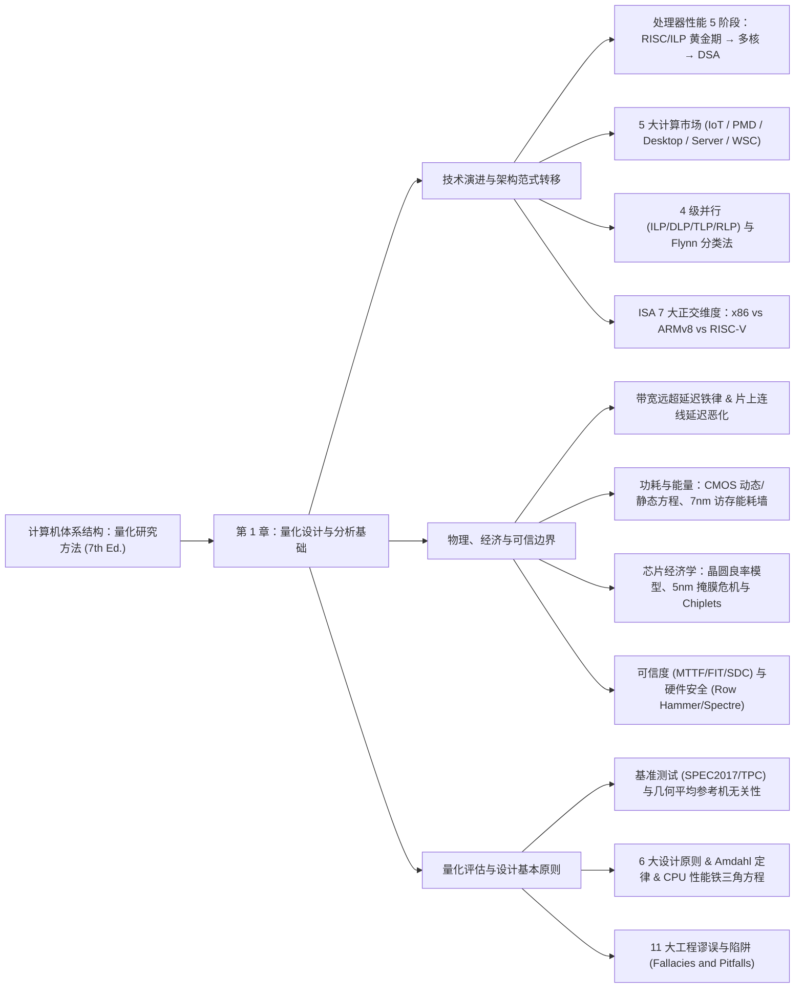

本系列为计算机体系结构领域的“圣经”级教材——John L. Hennessy、David A. Patterson 与 Christos Kozyrakis 合著的 **《Computer Architecture: A Quantitative Approach（计算机体系结构：量化研究方法）》第七版（7th Edition）** 的深度精读笔记与工程批注。

**系列特色**：紧扣第七版在**后摩尔定律与 AI 大模型时代**的全新修订内容，系统梳理从底层半导体工艺、能耗/成本/良率定量模型、可信度与硬件侧信道安全，到指令集架构（RISC-V）、存储层次、指令级/数据级/线程级/请求级并行以及领域专用架构（DSA）的完整量化设计方法论。

---

## 知识体系全景导图

---

## 章节目录与核心速览

| 章节 | 标题 | 核心知识点与精读批注 |
| :--- | :--- | :--- |
| **第 1 章** | [量化设计与分析基础](01.md) | 处理器性能 45 年演进五阶段、Dennard 缩放终结与摩尔定律放缓、五大计算市场与四级并行（ILP/DLP/TLP/RLP）、x86/ARMv8/RISC-V 七维对比、TSMC 7nm 算子与 DRAM 访存能耗鸿沟（$200,000\times$）、晶圆良率与 **Chiplets 异构集成经济学**、5nm 善变核心与静默数据损坏（SDC）、MTTF/MTTR/FIT 可靠性计算、Row Hammer 与 Spectre 侧信道攻击、SPECRatio 几何平均证明、**Amdahl 定律**与**处理器性能铁三角方程**、11 大谬误与陷阱 |

/// table-caption
《计算机体系结构：量化研究方法（第七版）》读书笔记系列导航表
///

---

## 核心量化公式速查卡

!!! info "第 1 章高频定量分析公式汇总"
    - **任务总能量与 CMOS 动态功率**：
      $$\text{Energy} = \text{Average Power} \times \text{Execution Time}, \qquad \text{Energy}_{\text{dynamic}} \propto C \cdot V^2, \qquad \text{Power}_{\text{dynamic}} \propto \frac{1}{2} C \cdot V^2 \cdot f$$
    - **晶圆切割、Bose-Einstein 良率与裸片成本**：
      $$\text{Dies per wafer} = \frac{\pi (\text{Wafer diameter}/2)^2}{\text{Die area}} - \frac{\pi \times \text{Wafer diameter}}{\sqrt{2 \times \text{Die area}}}, \qquad \text{Die yield} = \frac{\text{Wafer yield}}{(1 + \text{Defects per unit area} \times \text{Die area})^N}$$
      $$\text{Cost of die} = \frac{\text{Cost of wafer}}{\text{Dies per wafer} \times \text{Die yield}} \propto (\text{Die area})^2$$
    - **可靠性与可用性指标（MTTF / MTTR / MTBF / FIT）**：
      $$\text{MTBF} = \text{MTTF} + \text{MTTR}, \qquad \text{Availability} = \frac{\text{MTTF}}{\text{MTTF} + \text{MTTR}}, \qquad \text{FIT} = \frac{10^9}{\text{MTTF (hours)}}$$
    - **Amdahl 定律（Amdahl's Law）**：
      $$\text{Speedup}_{\text{overall}} = \frac{\text{Execution time}_{\text{old}}}{\text{Execution time}_{\text{new}}} = \frac{1}{(1 - \text{Fraction}_{\text{enhanced}}) + \dfrac{\text{Fraction}_{\text{enhanced}}}{\text{Speedup}_{\text{enhanced}}}}$$
    - **处理器性能铁三角方程（Processor Performance Equation）**：
      $$\text{CPU time} = \text{Instruction count (IC)} \times \text{Cycles per instruction (CPI)} \times \text{Clock cycle time}$$
