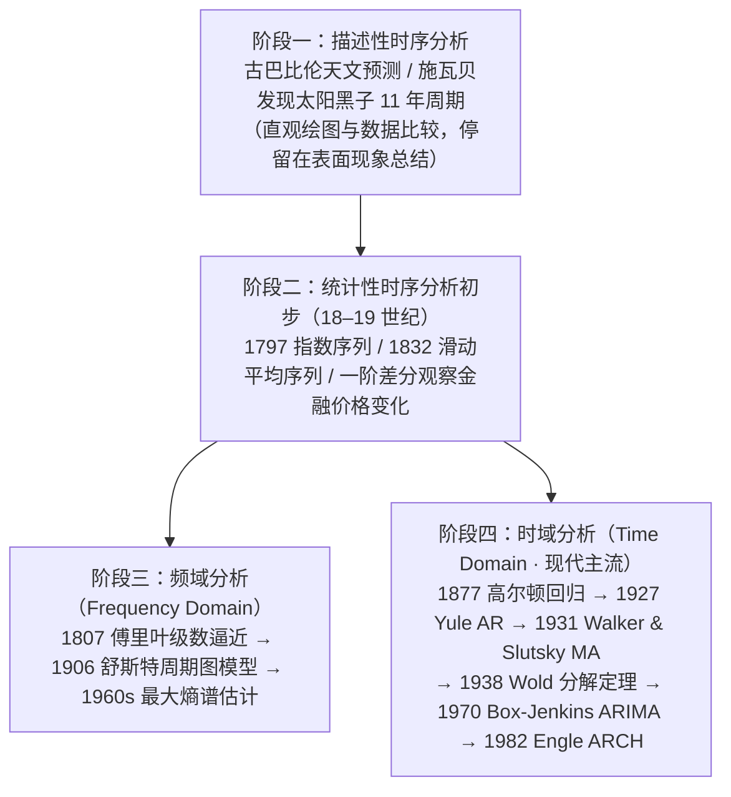

## 时间序列的定义与本质

### 历史起源与直观印象

人类对时间序列的观察可以追溯至 **7000 年前的古埃及**。古埃及人逐天记录尼罗河的涨落情况，通过对这一列数据长期的观察发现其背后极强的周期规律：每当天狼星第一次和太阳同时升起后的 **200 天左右**，尼罗河便开始泛滥，洪水大约持续 **70～80 天**，洪水退去后留下肥沃的淤泥，极适于农业耕种。

从直观上看，时间序列包含两大核心要素——**“时间”**与**“数据”**，分别对应两方面的信息：

- **顺序（Order）**：数据产生的时间先后次序不可随意打乱；
- **大小（Magnitude）**：每个时刻观测到的具体数值。

时间序列蕴含了客观世界及其变化的动态信息，表现着系统演化的动态过程，因此也被称为 ==动态数据（Dynamic Data）==（如电影单日票房曲线、股票每日收盘价曲线等）。

---

### 数学描述：确定性与随机性时间序列

在数学上，**时间序列（Time Series）**是指按时间顺序排列的一组数据，一般记为 $\{x(t),\, t = 0, 1, 2, \dots\}$ 或 $\{x_t\}$。根据生成机制的不同，可分为两类：

=== "确定性时间序列"
    如果 $x_t = f(t)$ 是某个**确定性函数** $f(\cdot)$ 在时刻 $t$ 的观测值（无随机误差干扰），则称为确定性时间序列。例如理想无阻尼简谐振动的位移序列。

=== "随机性时间序列（本课程核心研究对象）"
    如果 $\{X_t\}$ 是服从某种概率分布的**随机序列**，则称为随机性时间序列。

    !!! note "定义：观察值序列（样本实现）"
        从概率统计意义上来说，时间序列是按时间顺序排列的一个**随机序列**（或**随机过程**）$\{X(t),\, t \in T\}$ 在一系列时刻 $t_1, t_2, \dots, t_n$ 的**一次样本实现（Sample Realization）**：

        $$
        \{x_1, x_2, \dots, x_n\}
        $$

        这组实际观测到的数据也被称为**观察值序列**。

!!! tip "广义的“时间”坐标轴"
    时间序列中的“时间”具有**广义坐标轴**的含义：它既可以指按时间先后顺序排列的随机数据，也可以指按**空间位置先后顺序**或其他**物理量顺序**排列的随机数据（例如：某化工生产过程中沿管道不同位置采集的颜色属性序列、地质钻探沿深度采集的岩层密度序列）。

---

### 与传统统计分析的三大本质差异

初学者最容易将“时间序列数据”与传统数理统计中的“独立重复抽样样本”混淆。二者在**数据本质**、**分析目的**与**数据假设**上存在根本差异：

| 对比维度 | 时间序列分析（Time Series Analysis） | 传统统计分析（Classical Statistics） |
| :--- | :--- | :--- |
| **数据本质** | 观察值序列 $\{x_1, x_2, \dots, x_n\}$ 是**一个随机序列 $\{X_t\}$ 的一次实现**（每个时刻 $t$ 都是一个不同的随机变量 $X_t$，且每个变量只有 1 个观测值） | 观测数据 $(x_1, x_2, \dots, x_n)$ 是**同一个随机变量 $X$ 的多个实现**（对同一总体进行 $n$ 次重复抽样） |
| **分析目的** | 揭示**随机时序 $\{X_t\}$ 随时间演化的动态性质**与内在传递规律 | 揭示**单个或若干随机变量 $X$ 的静态分布性质** |
| **数据假设** | 观察序列中的前后数据之间==具有相关性（Autocorrelation）==（这正是建模的依据！） | 观测数据一般假设满足==独立同分布（i.i.d.）== |

/// table-caption
表 1-1：时间序列分析与传统数理统计分析的三大差异对比
///

???+ question "课堂随堂测试：纵向数据（时间序列） vs 截面数据"
    **题目**：下表为五位同学在春节期间（廿八至初三）每日抢红包金额（单位：元）的数据记录。请问时间序列分析研究的是哪一类数据？

    | 姓名 | 廿八 | 廿九 | 除夕 | 初一 | 初二 | 初三 |
    | :--- | :---: | :---: | :---: | :---: | :---: | :---: |
    | **赵一** | `2.20` | `5.62` | `30.20` | `16.88` | `5.31` | `0.64` |
    | **孙二** | 3.80 | 12.55 | **84.32** | 26.66 | 6.70 | 1.60 |
    | **张三** | 4.93 | 10.38 | **60.74** | 21.04 | 3.55 | 0.01 |
    | **李四** | 3.56 | 6.94 | **32.10** | 16.02 | 8.01 | 0.21 |
    | **王五** | 6.87 | 12.65 | **102.60** | 16.20 | 2.62 | 0.82 |

    - **A.** 同一人在“廿八 $\to$ 初三”连续多天的数据（如“赵一”整行数据）
    - **B.** 不同人在“除夕”同一天的数据（如“除夕”整列数据）

    ??? success "点击查看答案与解析"
        **答案：A**

        - **A（时间序列 / 纵向动态数据）**：记录了同一个体（赵一）随时间推移（廿八至初三）的动态变化过程，属于**时间序列数据**。
        - **B（截面数据 Cross-sectional Data）**：固定在“除夕”同一时刻，对不同个体（赵一至王五）的抽样观测，属于传统统计研究的**截面数据**。
        - 若同时综合分析多个人在多个时间点的数据，则构成计量经济学中的**面板数据（Panel Data）**。

---

### 时间序列的主要分类

按时间序列本身的性质与统计特征，可从以下三个维度进行分类：

=== "1. 按序列“元”的个数"
    - **一元时间序列（Univariate Time Series）**：仅包含单个因变量随时间变化的序列，如某只股票的每日收盘价序列 $\{x_t\}$。
    - **多元时间序列（Multivariate Time Series）**：同时观测多个相互关联的变量构成的向量序列 $\mathbf{X}_t = (X_{1t}, X_{2t}, \dots, X_{mt})^T$。例如 1978–2006 年全国财政收入与国内生产总值（GDP）构成的二元经济序列。

=== "2. 按统计特性"
    - **平稳时间序列（Stationary Time Series）**：序列的统计特性（均值、方差、自协方差结构等）不随时间平移而发生改变。这是经典时序模型（如 $\text{AR}$、$\text{MA}$、$\text{ARMA}$）的基石。
    - **非平稳时间序列（Non-stationary Time Series）**：统计特性随时间变化（通常包含趋势项、季节项或时变方差），一般需通过差分（如 $\text{ARIMA}$）或条件异方差模型（如 $\text{ARCH}/\text{GARCH}$）处理。

=== "3. 按元素取值形式"
    - **离散状态时间序列**：序列取值仅在有限个或可数无穷个离散状态中跳变，如每日天气类型序列（晴/阴/雨）、每日涨跌停状态序列。
    - **连续状态时间序列**：序列取值可在连续实数区间内任意变化，如气温、水位、股价等观测序列。

---

## 时间序列分析方法与发展历程

### 分析目的与方法定义

每个时间序列都蕴含了产生该序列的系统历史行为的全部信息。**时间序列分析的目的**正是提取这些信息，揭示序列本身的结构与规律，认识系统的固有特性，掌握系统与外界的关系，从而**推断系统及其行为的未来走向**。

!!! note "定义：时间序列分析（Time Series Analysis）"
    **时间序列分析**（简称**时序分析**或**时序方法**）是指采用**参数模型（特别是 $\text{ARMA}$ 模型）**对所观测到的有序随机数据进行分析与处理的一种数理统计方法。

    - **方法特色**：采用参数模型，将参数模型与系统分析结合，并与相应的客观事物和物理背景相互联系。

---

### 时序分析发展的四个里程碑阶段

从古巴比伦的天文观测到现代金融计量经济学，时间序列分析经历了四个关键发展阶段：

#### 描述性时序分析阶段
- **代表事件**：古巴比伦天文学家根据星体和卫星相对位置序列预测天文事件（成为开普勒定律的观测基础）；德国业余天文学家施瓦贝（Schwabe）经过数十年观测记录，发现太阳黑子活动具有约 **11 年**的周期规律。
- **特点与局限**：通过直观的数据比较或绘制时序图寻找规律，**操作简单、直观有效**（至今仍是统计时序分析的第一步）；但仅停留在表面现象的总结，无法深入揭示内在本质的相关关系。

#### 统计性时序分析的初步发展
- 19 世纪数学家开始研究金融时间序列建模，核心工具为**一阶差分**、**指数序列**（1797 年首次公开）和**滑动平均序列**（1832 年首次公开）。商人和金融家最早利用一阶差分 $\nabla x_t = x_t - x_{t-1}$ 观察价格和数量的重大变化。

#### 频域分析（Frequency Domain Analysis）的发展
- **核心原理**：假设任何一种无趋势的时间序列都可以分解成**若干不同频率的周期波动**（正余弦谐波分量）。
- **关键节点**：
    - **1807 年**：法国数学家傅里叶（Fourier）提出“正余弦项之和级数逼近”思想；
    - **1906 年**：德国学者舒斯特（Schuster）创建**周期图（Periodogram）**模型；
    - **20 世纪 60 年代**：引入**最大熵谱估计理论**，大幅提升谱分辨率，开创了频域分析的近代理论。

#### 时域分析（Time Domain Analysis · 主流方法）的发展
- **核心原理**：事件的发展通常具有**惯性（Inertia）**，用统计语言描述即**序列值之间存在相关关系**，且这种相关关系遵循某种统计规律。时域分析旨在找出该规律、拟合适当的参数数学模型，进而预测序列未来走势。
- **大师里程碑时间线**：

| 年份 | 学者 | 核心贡献与历史意义 |
| :---: | :--- | :--- |
| **1877** | 高尔顿（Galton）、皮尔逊（Pearson） | 研究甜豌豆亲子代种子及人类身高遗传关系，首次提出**回归（Regression）与相关系数**概念，成为时域利用滞后变量预测未来的思想根源 |
| **1927** | 尤尔（Yule） | 研究太阳黑子数序列周期时，首创 **$\text{AR}(2)$ 和 $\text{AR}(4)$ 自回归模型** |
| **1931** | 沃克（Walker）、斯卢茨基（Slutsky） | Walker 推导出一般 $\text{AR}(s)$ 模型；Slutsky 根据苏维埃彩票抽奖数字最后一位的 10 项滑动平均提出 **$\text{MA}(h)$ 滑动平均模型** |
| **1938** | 沃尔德（Wold） | 瑞典计量经济学家与统计学家 Wold 给出著名的 **Wold 分解定理**，奠定了用 **$\text{ARMA}$ 参数模型**拟合一切平稳序列的理论基石（实现了从非参数自协方差/功率谱估算到参数模型的重大突破） |
| **1970** | 博克斯（Box）、詹金斯（Jenkins） | 出版奠基巨著《时间序列分析：预测与控制》，提出非平稳自回归滑动平均 **$\text{ARIMA}$ 模型（Box-Jenkins 模型）**及“识别—估计—检验—预测”整套方法论 |
| **1982–1986** | 恩格尔（Engle）、波勒斯勒夫（Bollerslev） | Engle（1982）提出自回归条件异方差 **$\text{ARCH}$ 模型**（获 **2003 年诺贝尔经济学奖**）；其学生 Bollerslev（1986）提出 **$\text{GARCH}$ 模型**，衍生出 $\text{ARCH-M}$、$\text{EGARCH}$ 等非线性金融波动率模型族 |

/// table-caption
表 1-2：现代时域时间序列分析的里程碑事件
///

---

## 时间序列的四大应用领域

从宏观经济、金融证券到航空航天、气象水文、生物医学，时间序列的应用背景主要可归纳为以下四类：

1. **预报分析（Forecasting）**
   根据某个变化量的一段历史观测数据，预报该量在未来时刻的取值。
   - *金融预测*：根据上证指数、股票每日收盘价历史序列预测未来收益与波动走向。
   - *气象短临预报*：卫星云图短时降雨预报（如彩云天气 APP）——先将云图二维灰度矩阵进行**经验正交函数（EOF）分解**，提取代表云图空间分布的特征向量，再取方差贡献较大的前几个特征向量对应的**时间系数序列**建立时序预报模型。
   - *军事与工程*：无人机集群轨迹预测、目标机动航迹外推。

2. **控制分析（Control）**
   根据对一个或若干个量的一段观测结果建立统计控制模型，对系统参数进行优化调节以达到最优控制目标。
   - *电力电网调度*：记录某地区过去若干小时的用电负荷时间序列，分析得出供电系统与发电系统的最优负荷控制策略（预防电网级联崩溃）。

3. **诊断分析（Diagnosis）**
   根据两个不同时间序列的记录值判断它们是否具有相同属性，或根据单个序列判断系统是否出现异常状态。
   - *地震前兆监测*：地震观测站根据地下水位连续变化序列判断是否出现异常突变。
   - *医疗健康监护*：医务人员根据心电图 R-R 心跳间隔序列或**孕妇胎心监护序列**诊断胎儿是否处于缺氧等异常状态。

4. **频谱分析（Spectral Analysis）**
   根据时间序列的观测记录，识别序列中隐含的周期谐波分量，或对系统的频率响应特性进行统计分析（如机械振动故障特征频率提取、天文周期识别）。

---

## 课堂小结与自我检测

???+ question "课后巩固（多选题）：下列关于时间序列分析方法的说法正确的是？"
    - [x] **A.** 时间序列分析根据序列自身的变化规律（内部相关性）来预测未来
    - [x] **B.** 时间序列分析的数据是一组随机序列（随机过程）的一次样本实现
    - [ ] **C.** 时间序列分析主要根据某一变量与其它外部变量间的因果关系来预测未来
    - [ ] **D.** 时间序列分析的数据是对同一随机变量进行 $N$ 次独立重复实验的结果

    !!! tip "解析"
        正确选项为 **A、B**。选项 C 描述的是传统回归分析（因果回归），而选项 D 描述的是传统数理统计中的独立同分布（i.i.d.）抽样数据。

