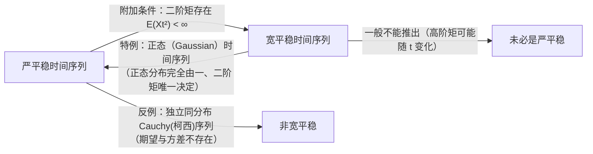

## 时间序列与随机过程

### 随机过程的数学定义

时间序列实质上是某个随机过程（或一族随机变量）的一个样本，因此时间序列的理论研究是以**随机过程（Stochastic Process）**为基础的。

!!! note "定义：随机过程"
    设 $(\Omega, \mathcal{F}, P)$ 为一概率空间，$T$ 是一参数集（通常为时间指标集，如 $T = \mathbb{Z}$ 或 $T = \{1, 2, \dots\}$）。如果对每一个固定的 $t \in T$，$X(t, \omega)$ 都是 $(\Omega, \mathcal{F}, P)$ 上的一个随机变量，则称：

    $$
    \{X(t, \omega),\ t \in T,\ \omega \in \Omega\}
    $$

    为概率空间 $(\Omega, \mathcal{F}, P)$ 上的一个**随机过程**，简记为 $\{X(t), t \in T\}$ 或 $\{X_t\}$。实质上它是一个**随机变量序列**。

### 随机过程与时间序列的二重性

随机过程 $X(t, \omega)$ 是关于时间参数 $t \in T$ 和样本点 $\omega \in \Omega$ 的二元函数，从不同视角固定其中一个变量可得：

| 观察视角 | 数学形式 | 统计含义 |
| :--- | :--- | :--- |
| **固定时刻 $t \in T$** | $X(t, \cdot)$ | 样本空间 $\Omega$ 上的一个**随机变量**，刻画系统在该时刻所有可能状态的概率分布 |
| **固定样本点 $\omega \in \Omega$** | $X(\cdot, \omega)$ | 时间 $t$ 的确定性函数，称为随机过程对应于 $\omega$ 的**样本函数（Sample Function）**，也称**实现（Realization）**或**轨道（Trajectory）**——**这就是本课程研究的时间序列 $\{x_t\}$** |

/// table-caption
表 1-3：随机过程 $X(t, \omega)$ 在固定 $t$ 与固定 $\omega$ 下的双重含义
///

### 统计特性的刻画：从联合分布族到低阶矩

- **单个随机变量**的统计特性由其**分布函数** $F(x) = P(X \le x)$ 完全决定；
- **随机过程 $\{X_t\}$** 的统计特性则由其**有限维分布函数族（多元联合分布族）**决定：对任意正整数 $m$ 及任意时刻 $t_1, t_2, \dots, t_m \in T$，联合分布函数定义为

$$
F_{t_1, t_2, \dots, t_m}(x_1, x_2, \dots, x_m) = P(X_{t_1} \le x_1,\ X_{t_2} \le x_2,\ \dots,\ X_{t_m} \le x_m)
$$

!!! warning "有限维分布函数族的实际局限性"
    在实际应用中，有限维分布函数族包含了无穷多个多元联合分布，几乎不可能通过有限样本完全获取或计算。因此，实际时序分析中通常退而求其次，采用**低阶矩（一阶矩和二阶矩）**——即时间序列的**数字特征（特征统计量）**来刻画其核心统计规律。

---

## 时间序列的特征统计量

设时间序列 $\{X_t, t \in T\}$ 的二阶矩存在，定义其四大核心特征统计量：

### 均值函数（Mean Function）

描述在时刻 $t$ 时随机变量 $X_t$ 的平均水平（反映序列的**长期趋势**）：

$$
\mu_t = E(X_t) = \int_{-\infty}^{+\infty} x \, \mathrm{d}F_t(x)
$$

### 方差函数（Variance Function）

刻画 $X_t$ 在时刻 $t$ 围绕均值 $\mu_t$ 的波动程度：

$$
\sigma_t^2 = D(X_t) = E\big[(X_t - E(X_t))^2\big] = E(X_t - \mu_t)^2
$$

### 自协方差函数（Autocovariance Function）

刻画两个不同时刻 $t$ 与 $s$ 的序列值 $X_t$ 与 $X_s$ 之间的线性相关程度：

$$
\gamma(t, s) = \operatorname{Cov}(X_t, X_s) = E\big[(X_t - \mu_t)(X_s - \mu_s)\big]
$$

- **对称性**：$\gamma(t, s) = \gamma(s, t)$；
- **退化为方差**：当 $s = t$ 时，$\gamma(t, t) = \operatorname{Cov}(X_t, X_t) = D(X_t) = \sigma_t^2$。

### 自相关系数（Autocorrelation Function, ACF）

标准化（无量纲化）后的自协方差，用于度量过去行为对现在的影响强弱：

$$
\rho(t, s) = \frac{\operatorname{Cov}(X_t, X_s)}{\sqrt{D(X_t)}\sqrt{D(X_s)}} = \frac{\gamma(t, s)}{\sigma_t \cdot \sigma_s}
$$

???+ example "课堂例题：求随机过程 $X_t = U \cos 2t$ 的均值与自协方差函数"
    **题目**：设随机过程 $X_t = U \cos 2t$，其中 $U$ 是随机变量，且已知 $E(U) = 5$，$D(U) = 6$。求均值函数 $E(X_t)$ 和自协方差函数 $\gamma(s, t)$。

    **解**：
    1. **求均值函数 $\mu_t$**：利用期望的线性性质（$\cos 2t$ 对期望而言是确定性常数因子）：

    $$
    E(X_t) = E(U \cos 2t) = \cos 2t \cdot E(U) = 5 \cos 2t
    $$

    2. **求自协方差函数 $\gamma(s, t)$**：

    $$
    \begin{aligned}
    \gamma(s, t) &= \operatorname{Cov}(U \cos 2s,\ U \cos 2t) \\
    &= \cos 2s \cos 2t \cdot \operatorname{Cov}(U, U) \\
    &= \cos 2s \cos 2t \cdot D(U) \\
    &= 6 \cos 2s \cos 2t
    \end{aligned}
    $$

    *(注：由于 $E(X_t) = 5\cos 2t$ 依赖于时间 $t$，且 $\gamma(s,t)$ 并非仅依赖于 $s-t$，因此该过程是非平稳过程。)*

---

## 平稳时间序列的定义：严平稳与宽平稳

平稳性（Stationarity）是时间序列分析最核心的假设，其本质思想是：**系统的统计规律不随时间的平移而发生改变**。根据约束强弱，分为**严平稳**与**宽平稳**两个层次。

### 严平稳（Strictly Stationary）

!!! note "定义：严平稳时间序列"
    设 $\{X_t\}$ 是一时间序列，若对任意正整数 $n$、任意时刻 $t_1, t_2, \dots, t_n \in T$ 以及任意时间平移量 $\tau$，其**一切有限维分布函数均随时间推移保持不变**：

    $$
    F_{t_1, t_2, \dots, t_n}(x_1, x_2, \dots, x_n) = F_{t_1+\tau, t_2+\tau, \dots, t_n+\tau}(x_1, x_2, \dots, x_n)
    $$

    则称 $\{X_t\}$ 为**严平稳时间序列**（或狭义平稳过程）。

- **性质一（边际分布同分布）**：令 $n = 1$，取 $\tau = -t_1$，得 $F_{t_1}(x_1) = F_0(x_1)$，即严平稳时间序列在所有时刻 $t$ 的**一维边际分布完全相同**。
- **性质二（二元分布仅依赖时间间隔）**：令 $n = 2$，取 $\tau = -t_1$，得 $F_{t_1, t_2}(x_1, x_2) = F_{0, t_2 - t_1}(x_1, x_2)$，即任意两时刻 $X_t$ 和 $X_s$ 的联合分布**只与时间间隔 $|t - s|$ 有关**，而与时间起点的位置无关。
- **局限性**：严平稳要求所有有限维分布均不变，条件过于严苛，在实际工程与经济数据中极难检验和计算，因此引入**宽平稳**。

---

### 宽平稳（Weakly / Wide-sense Stationary）

!!! note "定义：宽平稳时间序列（二阶平稳）"
    设 $\{X_t\}$ 是一时间序列，如果同时满足以下**三个条件**：

    1. **均值为常数**：对一切 $t \in T$，$E(X_t) = \mu$（与时间 $t$ 无关的常数）；
    2. **二阶矩存在（方差有限）**：对一切 $t \in T$，$E(X_t^2) < \infty$；
    3. **自协方差只依赖于时间间隔**：对一切 $t, s \in T$，自协方差函数 $\gamma(t, s) = \gamma(t + \tau, s + \tau)$ 只依赖于时间间隔 $\tau = t - s$，而与起止时刻的位置无关，故可简记为一元函数：

    $$
    \gamma(\tau) = \gamma(t - s) = \operatorname{Cov}(X_t, X_s) = \operatorname{Cov}(X_{s+\tau}, X_s)
    $$

    则称 $\{X_t\}$ 为**宽平稳时间序列**（或广义平稳、弱平稳时间序列）。

!!! important "本课程默认约定与零均值假设"
    - **默认指代**：在后续章节中，若不做特别说明，**“平稳时间序列”一律指宽平稳时间序列**。
    - **为什么可以直接假设宽平稳过程为零均值（$\mu = 0$）？**
      因为对任意均值 $\mu \ne 0$ 的宽平稳序列 $\{X_t\}$，令 $Y_t = X_t - \mu$（称为**中心化变换**），则 $E(Y_t) = 0$，且：

      $$
      \gamma_Y(t, s) = E(Y_t Y_s) = E\big[(X_t - \mu)(X_s - \mu)\big] = \gamma_X(t, s)
      $$

      即**零均值假设完全不影响自协方差函数 $\gamma(\tau)$ 和自相关系数 $\rho(\tau)$ 的值**！

???+ example "重要特例：零均值白噪声序列 $\text{WN}(0, \sigma^2)$"
    **题目**：设 $\{X_t\}$ 是一两两不相关的随机变量序列，且满足 $E(X_t) = 0$、$D(X_t) = \sigma^2 < \infty$，判断 $\{X_t\}$ 是否为宽平稳序列？

    **证明**：
    1. **均值**：$E(X_t) = 0$（常数）；
    2. **二阶矩**：$E(X_t^2) = D(X_t) + [E(X_t)]^2 = \sigma^2 < \infty$；
    3. **自协方差**：由两两不相关性，

    $$
    \gamma(t, s) = \operatorname{Cov}(X_t, X_s) = \begin{cases} \sigma^2, & t = s\ (\tau = 0), \\[4pt] 0, & t \ne s\ (\tau \ne 0). \end{cases}
    $$

    仅与时间间隔 $\tau = t - s$ 是否为 $0$ 有关，而与具体时刻 $t, s$ 无关。
    因此 $\{X_t\}$ 是宽平稳序列，称为**零均值白噪声（White Noise）**，记作 $\{X_t\} \sim \text{WN}(0, \sigma^2)$。它是构建一切 $\text{ARMA}$ 模型的基本“砖块”。

---

### 严平稳与宽平稳的辩证关系

严平稳的不变性体现在**联合概率分布函数**上，而宽平稳的不变性体现在**一、二阶矩（数字特征）**上。二者的逻辑关系如下：

=== "特例一：严平稳但非宽平稳（Cauchy 序列）"
    设 $\{X_t\}$ 是独立同分布（i.i.d.）且服从标准**柯西分布（Cauchy Distribution）**的时间序列，其概率密度函数为：

    $$
    f(x) = \frac{1}{\pi(1 + x^2)}, \qquad -\infty < x < +\infty
    $$

    - 因为 $\{X_t\}$ 独立同分布，其任意有限维联合分布均不随时间平移而改变，故 $\{X_t\}$ **一定是严平稳序列**。
    - 但由于广义积分 $\int_{-\infty}^{+\infty} \frac{|x|}{\pi(1+x^2)}\mathrm{d}x = +\infty$ 发散，其**一阶矩（期望）和二阶矩（方差）均不存在**！因此它**不是宽平稳序列**。

=== "特例二：宽平稳等价于严平稳（正态序列）"
    若 $\{X_t\}$ 是**正态（Gaussian）时间序列**（即任意有限维联合分布均为多元正态分布），由于多元正态分布完全由**均值向量（一阶矩）**和**协方差矩阵（二阶矩）**唯一确定：

    $$
    \text{正态时间序列 } \{X_t\}: \quad \text{宽平稳} \iff \text{严平稳}
    $$

---

### 平稳性与遍历性（Ergodicity）的重大统计意义

为什么平稳性在时间序列分析中具有不可替代的地位？这源于时间序列数据结构的特殊性：

1. **传统统计 vs 时间序列的样本困境**：
   - 在传统数理统计中，希望要分析的随机变量个数 $m$ 越少越好，而每个随机变量的独立重复观测样本量 $n$ 越大越好（大数定律保证样本均值收敛于总体均值）。
   - 而在时间序列 $\{X_t\}$ 中，每一个时刻 $t$ 的序列值 $X_t$ 都是一个不同的随机变量（共可列无穷多个随机变量），且**由于历史时间的不可重复性，每个随机变量 $X_t$ 在现实中只能获得唯一的一个样本观察值 $x_t$**！用 1 个样本点去估计 1 个随机变量的均值和方差在传统统计中是不可能的。
2. **平稳性与遍历性破局（以时间换空间）**：
   - **平稳性**使所有时刻的随机变量共享同一个均值 $\mu$ 和同一套延迟自协方差 $\gamma(\tau)$，**极大地减少了待估随机变量参数的个数**；
   - **时间维度上的“遍历性（Ergodicity）”**允许我们用一条样本轨道在不同时刻的**时间平均** $\bar{x} = \frac{1}{n}\sum_{t=1}^n x_t$ 去一致估计总体**空间（集合）平均** $\mu = E(X_t)$，从而将 $n$ 个时刻的单一观测转化为同一个参数的 $n$ 个样本容量，极大地简化了时序分析难度并提高了估计精度！

---

## 平稳时间序列自协方差函数的性质

对于宽平稳过程 $\{X_t\}$，方差为常数 $\sigma^2 = \gamma(0)$，延迟 $\tau$ 自协方差为 $\gamma(\tau) = \operatorname{Cov}(X_{t+\tau}, X_t)$，延迟 $\tau$ 自相关系数为：

$$
\rho(\tau) = \frac{\gamma(\tau)}{\sigma_t \cdot \sigma_{t+\tau}} = \frac{\gamma(\tau)}{\gamma(0)}
$$

### 定理 1：平稳过程自协方差函数的四大本质特征

!!! note "定理 1：自协方差函数 $\gamma(\tau)$ 与自相关系数 $\rho(\tau)$ 的基本性质"
    平稳随机过程 $\{X_t\}$ 的自协方差函数 $\gamma(\tau)$ 具有如下四条本质性质（右侧为 $\rho(\tau)$ 的对应性质）：

    1. **非负性 / 规范性**：$\gamma(0) = D(X_t) \ge 0$；对应自相关系数 **$\rho(0) \equiv 1$**。
    2. **有界性**：对一切整数 $\tau$，有

       $$
       |\gamma(\tau)| \le \gamma(0) \qquad \Longleftrightarrow \qquad |\rho(\tau)| \le 1
       $$

    3. **对称性（偶函数）**：对一切整数 $\tau$，有

       $$
       \gamma(\tau) = \gamma(-\tau) \qquad \Longleftrightarrow \qquad \rho(\tau) = \rho(-\tau)
       $$

    4. **非负定性（Non-negative Definiteness）**：对任意正整数 $m$，任意时刻 $t_1, \dots, t_m$ 及任意实数 $a_1, a_2, \dots, a_m \in \mathbb{R}$，二次型恒非负：

       $$
       \sum_{j=1}^m \sum_{k=1}^m \gamma(t_j - t_k) a_j a_k \ge 0 \qquad \Longleftrightarrow \qquad \sum_{j=1}^m \sum_{k=1}^m \rho(t_j - t_k) a_j a_k \ge 0
       $$

??? note "点击展开：有界性（性质 2）与非负定性（性质 4）的严格数学证明"
    #### 有界性 $|\gamma(\tau)| \le \gamma(0)$ 的证明（利用 Cauchy-Schwarz 不等式）
    由概率论中的 **Schwarz 不等式**：对任意方差有限的随机变量 $X$ 和 $Y$，恒有

    $$
    \big|\operatorname{Cov}(X, Y)\big|^2 \le D(X) \cdot D(Y)
    $$

    令 $X = X_{t+\tau}$，$Y = X_t$。因为 $\{X_t\}$ 平稳，故 $D(X_{t+\tau}) = D(X_t) = \gamma(0)$，代入不等式得：

    $$
    |\gamma(\tau)|^2 = \big|\operatorname{Cov}(X_{t+\tau}, X_t)\big|^2 \le D(X_{t+\tau}) \cdot D(X_t) = \big[\gamma(0)\big]^2
    $$

    两边开平方即证得 $|\gamma(\tau)| \le \gamma(0)$，两边同除以 $\gamma(0)$ 得 $|\rho(\tau)| \le 1$。

    ---

    #### 非负定性（性质 4）的证明
    对任意正整数 $m$、任意时刻 $t_1, \dots, t_m$ 和任意实数 $a_1, \dots, a_m$，构造线性组合随机变量 $Z = \sum_{j=1}^m a_j X_{t_j}$。因为任何随机变量的方差必然非负（$D(Z) \ge 0$），将 $D(Z)$ 展开：

    $$
    \begin{aligned}
    0 \le D\left(\sum_{j=1}^m a_j X_{t_j}\right)
    &= \operatorname{Cov}\left(\sum_{j=1}^m a_j X_{t_j},\ \sum_{k=1}^m a_k X_{t_k}\right) \\
    &= \sum_{j=1}^m \sum_{k=1}^m a_j a_k \operatorname{Cov}(X_{t_j}, X_{t_k}) \\
    &= \sum_{j=1}^m \sum_{k=1}^m \gamma(t_j - t_k) a_j a_k
    \end{aligned}
    $$

    即证得 $\gamma(\tau)$（以及 $\rho(\tau) = \gamma(\tau)/\gamma(0)$）具有非负定性。

### 定理 2：平稳过程的存在性定理

!!! info "定理 2（自协方差函数的充要条件）"
    定义在整数集 $\mathbb{Z}$ 上的实值偶函数 $\gamma(\cdot)$ 是**非负定函数**的充要条件是：$\gamma(\cdot)$ 是某一个宽平稳随机过程的自协方差函数。

    *(证明思路：必要性由定理 1 已证；充分性可通过以 $\gamma(t_j - t_k)$ 为协方差矩阵构造相容的多元正态分布函数族，并利用 **Kolmogorov 存在性定理**证得。)*

---

## 经典平稳性判别习题精解

在考试中，**“利用宽平稳定义的三个条件判别给定序列是否平稳”**是必考基础题型。下面整理课件中的三道经典母题：

=== "习题 1：一阶滑动平均序列"
    **题目**：设 $\{z_t\}$ 是独立同分布随机变量序列，且 $E(z_t) = 0$、$D(z_t) = \sigma^2 < \infty$。定义序列：

    $$
    x_t = z_t + \theta z_{t-1} \quad (\theta \text{ 为实常数})
    $$

    判断 $\{x_t\}$ 是否为一个宽平稳序列？

    **解**：逐一检验宽平稳的三个条件：
    1. **均值**：

       $$
       E(x_t) = E(z_t) + \theta E(z_{t-1}) = 0 + \theta \cdot 0 \equiv 0 \quad (\text{常数})
       $$

    2. **二阶矩（方差）**：由于 $z_t$ 与 $z_{t-1}$ 独立（不相关），

       $$
       D(x_t) = D(z_t) + \theta^2 D(z_{t-1}) = (1 + \theta^2)\sigma^2 < \infty
       $$

    3. **自协方差 $\gamma(t, t+\tau)$**：

       $$
       \begin{aligned}
       \gamma(t, t+\tau) &= \operatorname{Cov}(z_t + \theta z_{t-1},\ z_{t+\tau} + \theta z_{t+\tau-1}) \\
       &= \operatorname{Cov}(z_t, z_{t+\tau}) + \theta \operatorname{Cov}(z_t, z_{t+\tau-1}) + \theta \operatorname{Cov}(z_{t-1}, z_{t+\tau}) + \theta^2 \operatorname{Cov}(z_{t-1}, z_{t+\tau-1}) \\
       &= \begin{cases}
       (1 + \theta^2)\sigma^2, & \tau = 0, \\[4pt]
       \theta \sigma^2, & \tau = \pm 1, \\[4pt]
       0, & |\tau| > 1.
       \end{cases}
       \end{aligned}
       $$

       可见 $\gamma(t, t+\tau)$ **仅与时间间隔 $\tau$ 有关**，与时刻 $t$ 无关。

    **结论**：$\{x_t\}$ 是宽平稳序列（即一阶滑动平均过程 $\text{MA}(1)$）。

=== "习题 2：交错调幅序列 $x_t = (-1)^t y_t$"
    **题目**：设 $x_t = (-1)^t y_t$，其中 $\{y_t\}$ 是宽平稳时间序列（设 $E(y_t) = \mu \ne 0$），判断 $\{x_t\}$ 是否为宽平稳序列？

    **解**：考察均值函数 $E(x_t)$：

    $$
    E(x_t) = (-1)^t E(y_t) = (-1)^t \mu = \begin{cases} \mu, & t \text{ 为偶数}, \\[4pt] -\mu, & t \text{ 为奇数}. \end{cases}
    $$

    当 $\mu \ne 0$ 时，$E(x_t)$ 随时间 $t$ 的奇偶性正负交替变化，**不是常数**，违反了宽平稳的第一条定义！

    **结论**：当 $E(y_t) \ne 0$ 时，$\{x_t\}$ **不是平稳序列**。
    *(思考扩展：若已知 $\{y_t\}$ 是零均值宽平稳序列 $\mu = 0$，则 $E(x_t) \equiv 0$，且 $\gamma_x(t, t+\tau) = (-1)^{2t+\tau}\gamma_y(\tau) = (-1)^\tau \gamma_y(\tau)$ 仅依赖于 $\tau$，此时 $\{x_t\}$ 平稳！)*

=== "习题 3：一般 $q$ 阶滑动平均序列 $\text{MA}(q)$"
    **题目**：设 $\{\varepsilon_t\} \sim \text{WN}(0, \sigma^2)$，对于非负整数 $q$ 和常数 $\{a_0, a_1, \dots, a_q\}$，考察序列：

    $$
    X_t = a_0 \varepsilon_t + a_1 \varepsilon_{t-1} + \cdots + a_q \varepsilon_{t-q} = \sum_{j=0}^q a_j \varepsilon_{t-j}
    $$

    判断 $\{X_t\}$ 是否为宽平稳序列？

    **解**：
    1. **均值**：$E(X_t) = \sum_{j=0}^q a_j E(\varepsilon_{t-j}) \equiv 0$（常数）；
    2. **方差**：因 $\{\varepsilon_t\}$ 两两不相关，$D(X_t) = \sigma^2 \sum_{j=0}^q a_j^2 < \infty$；
    3. **自协方差**（不妨设 $\tau \ge 0$）：

       $$
       \begin{aligned}
       \gamma(t, t+\tau) &= \operatorname{Cov}\left(\sum_{j=0}^q a_j \varepsilon_{t-j},\ \sum_{k=0}^q a_k \varepsilon_{t+\tau-k}\right) \\
       &= \sum_{j=0}^q \sum_{k=0}^q a_j a_k \operatorname{Cov}(\varepsilon_{t-j}, \varepsilon_{t+\tau-k})
       \end{aligned}
       $$

       仅当下标相等 $t - j = t + \tau - k \iff k = j + \tau$ 时协方差为 $\sigma^2$，其余均为 $0$。因此：

       $$
       \gamma(\tau) = \begin{cases}
       \sigma^2 \displaystyle\sum_{j=0}^{q-|\tau|} a_j a_{j+|\tau|}, & |\tau| \le q, \\[10pt]
       0, & |\tau| > q.
       \end{cases}
       $$

       仅依赖于时间间隔 $\tau$。

    **结论**：任意有限阶滑动平均序列 $\{X_t\}$（记作 $\text{MA}(q)$）**恒为宽平稳时间序列**！

