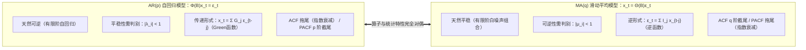

在学完自回归模型 $\text{AR}(p)$ 后，本节进入 $\text{ARMA}$ 家族的第二大支柱——**滑动平均模型（Moving Average Model, $\text{MA}(q)$）**。我们将从金融市场“黑天鹅”冲击的建模背景出发，推导 $\text{MA}(q)$ 的五大统计特性（重点掌握**时间轴重叠项法求自协方差**与 **$q$ 阶截尾性**），并深入剖析 $\text{MA}$ 模型独有的核心概念——**可逆性（Invertibility）**。

---

## MA 模型的产生背景与定义

### 为什么有了 $\text{AR}$ 模型还需要 $\text{MA}$ 模型？

在课堂上，老师以 **2020 年 3 月 12 日美股暴跌熔断（疫情爆发引发的“黑天鹅”事件）** 为例阐述了 $\text{MA}$ 模型的物理背景：

- **$\text{AR}$ 模型的局限**：$\text{AR}(p)$ 模型假设当前观测值 $x_t$ 主要由过去观测值 $x_{t-1}, \dots, x_{t-p}$ 的线性组合决定（系统自身状态的惯性记忆）。但在金融市场剧烈波动、突发政策或外部冲击频发的场景下，历史观测值本身的惯性记忆很弱，反而是**当前及过去几期的外部突发随机干扰（白噪声扰动 $\varepsilon_t, \varepsilon_{t-1}, \dots$）对当前状态 $x_t$ 起主导作用**。
- **$\text{MA}$ 模型的思想**：放弃用过去的观测值 $x_{t-i}$ 建模，转而将当前观测值 $x_t$ 直接表示为**当期白噪声扰动 $\varepsilon_t$ 与过去有限期历史扰动 $\varepsilon_{t-1}, \dots, \varepsilon_{t-q}$ 的线性组合（加权滑动平均）**——这就是刻画“外部扰动记忆”的**滑动平均模型（Moving Average, $\text{MA}$）**。

---

### $\text{MA}(1)$ 与 $\text{MA}(q)$ 模型的数学定义

=== "一阶滑动平均模型 $\text{MA}(1)$"
    若当前观测值 $x_t$ 仅受当期扰动 $\varepsilon_t$ 和上一期扰动 $\varepsilon_{t-1}$ 的影响（一期扰动记忆）：

    $$
    x_t = \theta_0 + \varepsilon_t - \theta_1 \varepsilon_{t-1}
    $$

    称为**一阶滑动平均模型**，简记为 $\text{MA}(1)$。其中：
    - $\theta_1 \ne 0$ 为滑动平均参数；$\{\varepsilon_t\} \sim \text{WN}(0, \sigma^2)$ 为零均值白噪声；
    - 当常数项 $\theta_0 = 0$ 时，称为**中心化 $\text{MA}(1)$ 模型**：

      $$
      x_t = \varepsilon_t - \theta_1 \varepsilon_{t-1} = (1 - \theta_1 B)\varepsilon_t
      $$

    - **未知参数个数**：中心化 $\text{MA}(1)$ 模型包含 **$2$ 个未知参数**——滑动平均系数 $\theta_1$ 和白噪声方差 $\sigma^2$。

=== "$q$ 阶滑动平均模型 $\text{MA}(q)$"
    !!! note "定义：$q$ 阶滑动平均模型 $\text{MA}(q)$"
        具有如下结构的模型称为 **$q$ 阶滑动平均模型**，简记为 $\text{MA}(q)$：

        $$
        x_t = \theta_0 + \varepsilon_t - \theta_1 \varepsilon_{t-1} - \theta_2 \varepsilon_{t-2} - \cdots - \theta_q \varepsilon_{t-q}
        $$

        其中 $\theta_q \ne 0$，$\{\varepsilon_t\} \sim \text{WN}(0, \sigma^2)$。
        - 当 $\theta_0 = 0$ 时，称为**中心化 $\text{MA}(q)$ 模型**（若 $\theta_0 \ne 0$，令 $y_t = x_t - \theta_0$ 即可中心化）：

        $$
        x_t = \varepsilon_t - \theta_1 \varepsilon_{t-1} - \theta_2 \varepsilon_{t-2} - \cdots - \theta_q \varepsilon_{t-q} = \Theta(B)\varepsilon_t
        $$

        其中算子多项式

        $$
        \Theta(B) = 1 - \theta_1 B - \theta_2 B^2 - \cdots - \theta_q B^q
        $$

        称为 $\text{MA}(q)$ 模型的**滑动平均系数多项式**。

!!! warning "教材符号正负号约定提醒"
    国内主流教材（王燕、易丹辉《应用时间序列分析》）及本课程统一采用**减号约定**：$x_t = \varepsilon_t - \theta_1 \varepsilon_{t-1} - \cdots - \theta_q \varepsilon_{t-q}$。在代公式求自协方差 $\gamma_k$ 和自相关系数 $\rho_k$ 时，务必看清题目给定的式子是减号还是加号（例如 $x_t = \varepsilon_t + 0.5\varepsilon_{t-1}$ 对应 $\theta_1 = -0.5$）！

---

## MA 模型的统计特性（均值、方差、ACF 与 PACF）

下面针对中心化 $\text{MA}(q)$ 模型 $x_t = \varepsilon_t - \theta_1 \varepsilon_{t-1} - \cdots - \theta_q \varepsilon_{t-q}$ 推导其统计特征（可统一记 $\psi_0 = 1,\ \psi_j = -\theta_j\ (1 \le j \le q)$，则 $x_t = \sum_{j=0}^q \psi_j \varepsilon_{t-j}$）。

### 均值与方差（比 $\text{AR}$ 模型简单得多！）

1. **均值 $\mu = E(x_t)$**：
   两边同时取期望，因 $E(\varepsilon_{t-j}) = 0$，故中心化 $\text{MA}(q)$ 模型的均值恒为 $0$（非中心化模型均值为 $E(x_t) = \theta_0$）：

   $$
   \boxed{E(x_t) = 0}
   $$

2. **方差 $\gamma_0 = D(x_t)$**：
   与 $\text{AR}(p)$ 模型不同，$\text{MA}(q)$ 右边的白噪声项 $\varepsilon_t, \varepsilon_{t-1}, \dots, \varepsilon_{t-q}$ **两两互不相关**！因此两边取方差时**可以直接按独立和逐项展开**（注意 $(-\theta_j)^2 = +\theta_j^2$，课堂上老师特别提醒切勿把平方项写成减号！）：

   $$
   \boxed{\gamma_0 = D(x_t) = \big(1 + \theta_1^2 + \theta_2^2 + \cdots + \theta_q^2\big)\sigma^2 = \sigma^2 \sum_{j=0}^q \theta_j^2 \qquad (\text{约定 } \theta_0 = -1)}
   $$

   - 特例 **$\text{MA}(1)$ 方差**：$\gamma_0 = (1 + \theta_1^2)\sigma^2$；
   - 特例 **$\text{MA}(2)$ 方差**：$\gamma_0 = (1 + \theta_1^2 + \theta_2^2)\sigma^2$。

---

### 自协方差函数 $\gamma_k$（课堂“时间轴重叠项”推导法）

求延迟 $k\ (k \ge 1)$ 阶自协方差 $\gamma_k = E(x_t x_{t-k})$：

$$
\gamma_k = E\big[(\varepsilon_t - \theta_1 \varepsilon_{t-1} - \cdots - \theta_q \varepsilon_{t-q})(\varepsilon_{t-k} - \theta_1 \varepsilon_{t-k-1} - \cdots - \theta_q \varepsilon_{t-k-q})\big]
$$

由于白噪声序列 $\{\varepsilon_t\}$ 仅在**下标完全相同时**才有 $E(\varepsilon_s \varepsilon_s) = \sigma^2$，下标不同时乘积期望全为 $0$。课堂上老师给出了直观的**时间轴区间重叠分析法**：

- 第一个括号 $x_t$ 包含的白噪声时间下标范围为：$[t - q,\ t]$；
- 第二个括号 $x_{t-k}$ 包含的白噪声时间下标范围为：$[t - k - q,\ t - k]$。

```
x_t 的下标区间:          t-q .......... t-k .......... t-1   t
                          |==============|==============|
x_{t-k} 的下标区间:  t-k-q .......... t-q .......... t-k
                      |==============|==============|
                                     ^--------------^
                                  重叠区间 [t-q, t-k]（仅当 1 ≤ k ≤ q 时存在！）
```

- **当 $1 \le k \le q$ 时**：两个区间在 $[t-q,\ t-k]$ 上发生重叠，共有 $q - k + 1$ 对下标相同的白噪声项相乘非零：
    - 下标 $t-k$ 项：$(-\theta_k \varepsilon_{t-k}) \cdot (1 \cdot \varepsilon_{t-k}) \implies -\theta_k \sigma^2$
    - 下标 $t-k-1$ 项：$(-\theta_{k+1} \varepsilon_{t-k-1}) \cdot (-\theta_1 \varepsilon_{t-k-1}) \implies +\theta_1 \theta_{k+1} \sigma^2$
    - $\cdots$
    - 下标 $t-q$ 项：$(-\theta_q \varepsilon_{t-q}) \cdot (-\theta_{q-k} \varepsilon_{t-q}) \implies +\theta_{q-k} \theta_q \sigma^2$
- **当 $k > q$ 时**：$t - k < t - q$，两个时间下标区间**完全错开、没有任何重叠项**，因此乘积期望恒等于 $0$！

综合起来，得到 **$\text{MA}(q)$ 模型的自协方差函数通式**：

$$
\boxed{
\gamma_k = \begin{cases}
(1 + \theta_1^2 + \theta_2^2 + \cdots + \theta_q^2)\sigma^2, & k = 0, \\[8pt]
\left(-\theta_k + \theta_1 \theta_{k+1} + \theta_2 \theta_{k+2} + \cdots + \theta_{q-k} \theta_q\right)\sigma^2 = \sigma^2 \displaystyle\sum_{j=0}^{q-k} \psi_j \psi_{j+k}, & 1 \le k \le q, \\[12pt]
0, & k > q.
\end{cases}
}
$$

!!! success "核心定理：有限阶 $\text{MA}(q)$ 模型无条件平稳（恒平稳）！"
    由上述计算直接验证宽平稳的三个条件：
    1. 均值 $E(x_t) = 0$ 为常数；
    2. 方差 $\gamma_0 = (1 + \sum_{j=1}^q \theta_j^2)\sigma^2 < \infty$ 恒存在；
    3. 自协方差 $\gamma_k$ **仅与时间间隔 $k$ 有关**，与起始时刻 $t$ 无关。

    因此，**无论系数 $\theta_1, \dots, \theta_q$ 取任何有限实数值，有限阶 $\text{MA}(q)$ 模型永远是平稳时间序列，无需进行平稳性判别！**

---

### 自相关系数（ACF）与 **$q$ 阶截尾性**

将 $\gamma_k$ 除以 $\gamma_0$，即得 **$\text{MA}(q)$ 模型的自相关系数（ACF）通式**：

$$
\boxed{
\rho_k = \frac{\gamma_k}{\gamma_0} = \begin{cases}
1, & k = 0, \\[8pt]
\dfrac{-\theta_k + \theta_1 \theta_{k+1} + \cdots + \theta_{q-k} \theta_q}{1 + \theta_1^2 + \theta_2^2 + \cdots + \theta_q^2}, & 1 \le k \le q, \\[12pt]
0, & k > q.
\end{cases}
}
$$

由此可见，$\text{MA}(q)$ 模型的自相关系数具有**==$q$ 阶截尾性（Cutoff after lag $q$）==**：当滞后阶数 $k > q$ 时，$\rho_k \equiv 0$（而由于 $\theta_q \ne 0$，第 $q$ 阶 $\rho_q = \frac{-\theta_q}{1+\theta_1^2+\cdots+\theta_q^2} \ne 0$）。这是从样本 ACF 图识别 $\text{MA}(q)$ 模型及其阶数 $q$ 的直接依据！

=== "$\text{MA}(1)$ 自相关系数公式（课堂默写重点）"
    对 $x_t = \varepsilon_t - \theta_1 \varepsilon_{t-1}$：

    $$
    \rho_k = \begin{cases}
    1, & k = 0, \\[6pt]
    -\dfrac{\theta_1}{1 + \theta_1^2}, & k = 1, \\[10pt]
    0, & k \ge 2.
    \end{cases}
    $$

    *(性质：由均值不等式 $1 + \theta_1^2 \ge 2|\theta_1|$，可知 **$\text{MA}(1)$ 的一阶自相关系数绝对值存在理论上界 $|\rho_1| \le 0.5$**！)*

=== "$\text{MA}(2)$ 自相关系数公式（课堂默写重点）"
    对 $x_t = \varepsilon_t - \theta_1 \varepsilon_{t-1} - \theta_2 \varepsilon_{t-2}$：

    $$
    \rho_k = \begin{cases}
    1, & k = 0, \\[6pt]
    \dfrac{-\theta_1 + \theta_1 \theta_2}{1 + \theta_1^2 + \theta_2^2} = \dfrac{\theta_1(\theta_2 - 1)}{1 + \theta_1^2 + \theta_2^2}, & k = 1, \\[12pt]
    -\dfrac{\theta_2}{1 + \theta_1^2 + \theta_2^2}, & k = 2, \\[12pt]
    0, & k \ge 3.
    \end{cases}
    $$

---

### $\text{MA}(q)$ 模型的偏自相关系数（PACF）：**拖尾性**

对于 $\text{MA}(q)$ 模型，其偏自相关系数 $\phi_{kk}$ 的求解方法与 $\text{AR}$ 模型完全一致——先算出自相关系数 $\rho_1, \dots, \rho_q$（$k > q$ 时 $\rho_k = 0$），再代入 **$k$ 阶 Yule-Walker 方程组**用 Cramer 法则求解：

- **$k = 1$**：$\phi_{11} = \rho_1$；
- **$k = 2$**：$\phi_{22} = \frac{\rho_2 - \rho_1^2}{1 - \rho_1^2}$；
- **$k = 3$**（以 $\text{MA}(1)$ 为例，因 $\rho_2 = \rho_3 = 0$）：$\phi_{33} = \frac{\rho_1^3}{1 - 2\rho_1^2}$。

对于 $\text{MA}(1)$ 模型，可严格证明其 $k$ 阶偏自相关系数闭式解为：

$$
\phi_{kk} = -\frac{\theta_1^k (1 - \theta_1^2)}{1 - \theta_1^{2(k+1)}} \qquad (k \ge 1)
$$

可见，**$\text{MA}(q)$ 模型的偏自相关系数（PACF）不会在某阶后截断为 $0$，而是呈现指数衰减的==拖尾性（Tailing Off）==**！

---

## MA 模型的可逆性（Invertibility）与逆函数

### 问题的引出：自相关系数的非唯一性困境

先看课堂上的经典练习题（对应 `笔记.md`）：

???+ example "课堂练习题：由一阶自相关系数 $\rho_1 = 0.4$ 反求 $\text{MA}(1)$ 模型"
    **题目**：已知某中心化 $\text{MA}(1)$ 模型 $X_t = \varepsilon_t - \theta \varepsilon_{t-1}$ 的一阶自相关系数为 $\rho_1 = 0.4$，求该模型的表达式。

    **解**：
    将 $\rho_1 = 0.4$ 代入 $\text{MA}(1)$ 的一阶自相关公式：

    $$
    \rho_1 = -\frac{\theta}{1 + \theta^2} = 0.4 \quad \implies \quad 0.4\theta^2 + \theta + 0.4 = 0 \quad \implies \quad 2\theta^2 + 5\theta + 2 = 0
    $$

    因式分解 $(2\theta + 1)(\theta + 2) = 0$，解得**两个互为倒数的实根**：

    $$
    \theta = -\frac{1}{2} = -0.5 \qquad \text{或} \qquad \theta = -2
    $$

    这意味着以下两个不同的 $\text{MA}(1)$ 模型：
    - 模型 A：$X_t = \varepsilon_t + 0.5\varepsilon_{t-1}$（对应 $\theta = -0.5$）
    - 模型 B：$X_t = \varepsilon_t + 2\varepsilon_{t-1}$（对应 $\theta = -2$）

    拥有**完全相同的自相关系数序列**（$\rho_0 = 1,\ \rho_1 = 0.4,\ \rho_k = 0\ (k \ge 2)$）！

事实上，对任意 $\text{MA}(1)$ 模型，若将参数 $\theta_1$ 替换为倒数 $1/\theta_1$：

$$
\rho_1\left(\frac{1}{\theta_1}\right) = \frac{-1/\theta_1}{1 + (1/\theta_1)^2} = \frac{-\theta_1}{\theta_1^2 + 1} = \rho_1(\theta_1)
$$

自相关系数完全不变！推广到 $\text{MA}(2)$ 模型，若将 $(\theta_1, \theta_2)$ 替换为 $(\theta_1/\theta_2,\ 1/\theta_2)$，自相关系数同样不变（一套 $\text{MA}(2)$ 自相关系数最多可对应 **4 个不同的 $\text{MA}(2)$ 模型**！）。

<div class="custom-block" markdown>
**为什么要引入“可逆性”约束？**
在实际建模中，我们只能观测到样本数据 $\{x_t\}$，并通过样本估计出自相关系数 $\hat{\rho}_k$，再反推模型参数 $\theta_j$。如果同一组自相关系数对应多个不同的 $\text{MA}$ 模型（**模型表示的非唯一性**），参数估计就会陷入多解歧义。
为此，必须给 $\text{MA}$ 模型增加一个约束条件——**可逆性（Invertibility）**，使得**每一组合法的自相关系数序列只唯一对应一个可逆的 $\text{MA}$ 模型**！
</div>

---

### 可逆性与逆函数 $I_j$ 的定义及统计意义

在 $\text{AR}$ 模型中，我们通过 **Green 函数 $G_j$** 将观测序列 $x_t$ 表示为白噪声 $\varepsilon_{t-j}$ 的无穷线性组合（$x_t = \sum_{j=0}^\infty G_j \varepsilon_{t-j}$）。
现在反过来思考：**能不能用可观测的历史数据 $x_t, x_{t-1}, \dots$ 的无穷线性组合（收敛的自回归形式）来表示不可观测的白噪声扰动 $\varepsilon_t$？**

!!! note "定义：可逆模型与逆函数（Inverse Function）"
    如果一个时间序列模型可以表示为如下**绝对可和（收敛）的无穷阶自回归形式**：

    $$
    \varepsilon_t = \sum_{j=0}^\infty I_j x_{t-j} \qquad \Longleftrightarrow \qquad x_t = -I_1 x_{t-1} - I_2 x_{t-2} - \cdots + \varepsilon_t \quad (I_0 \equiv 1)
    $$

    且权重系数满足绝对收敛条件 $\sum_{j=0}^\infty |I_j| < \infty$，则称该模型为**可逆模型（Invertible Model）**，称系数序列 $\{I_j\}$ 为该模型的**逆函数**。

- **统计意义**：在实际问题中，白噪声扰动 $\varepsilon_t$ 是无法直接测量的，而历史序列值 $x_t, x_{t-1}, \dots$ 是已知的观测数据。只有当模型**可逆**时，我们才能利用已知的历史观测数据 $x_{t-j}$ 唯一、稳定地重构和估计出当期随机扰动 $\varepsilon_t$，且久远历史观测 $x_{t-j}\ (j \to \infty)$ 对当前的影响会按指数衰减至 $0$！
- **重要推论**：有限阶 **$\text{AR}(p)$ 模型本身就是有限项的自回归形式，因此有限阶 $\text{AR}(p)$ 模型恒可逆（无条件可逆）**！

---

### $\text{MA}(1)$ 与 $\text{MA}(q)$ 模型的可逆性判别准则

#### $\text{MA}(1)$ 模型的可逆条件推导
对中心化 $\text{MA}(1)$ 模型 $x_t = \varepsilon_t - \theta_1 \varepsilon_{t-1} = (1 - \theta_1 B)\varepsilon_t$，不断将 $\varepsilon_{t-k} = x_{t-k} + \theta_1 \varepsilon_{t-k-1}$ 向过去迭代展开：

$$
\begin{aligned}
\varepsilon_t &= x_t + \theta_1 \varepsilon_{t-1} \\
&= x_t + \theta_1 (x_{t-1} + \theta_1 \varepsilon_{t-2}) \\
&= \cdots = \sum_{j=0}^k \theta_1^j x_{t-j} + \theta_1^{k+1} \varepsilon_{t-k-1}
\end{aligned}
$$

（或用算子级数展开 $\varepsilon_t = (1 - \theta_1 B)^{-1} x_t = \sum_{j=0}^\infty \theta_1^j B^j x_t = \sum_{j=0}^\infty \theta_1^j x_{t-j}$）。
要使余项 $\theta_1^{k+1}\varepsilon_{t-k-1} \to 0\ (k \to \infty)$ 且级数收敛，充要条件是：

$$
\boxed{|\theta_1| < 1}
$$

此时 $\text{MA}(1)$ 的逆函数为 $I_j = -\theta_1^j\ (j \ge 1)$。
回看刚才的练习题（$\rho_1 = 0.4$ 解出 $\theta = -0.5$ 或 $\theta = -2$）：由于可逆性要求 $|\theta| < 1$，舍去 $\theta = -2$，**唯一可逆的 $\text{MA}(1)$ 模型为 $X_t = \varepsilon_t + 0.5\varepsilon_{t-1}$**！

---

#### 一般 $\text{MA}(q)$ 模型的可逆性判别（与 $\text{AR}(p)$ 平稳性完全对偶！）

对 $\text{MA}(q)$ 模型 $x_t = \Theta(B)\varepsilon_t = (1 - \theta_1 B - \theta_2 B^2 - \cdots - \theta_q B^q)\varepsilon_t$，定义其对应的**滑动平均特征方程**（为与 $\text{AR}$ 的特征根 $\lambda$ 区分，记为 $\mu$）：

$$
\mu^q - \theta_1 \mu^{q-1} - \theta_2 \mu^{q-2} - \cdots - \theta_q = 0
$$

设其 $q$ 个特征根为 $\mu_1, \mu_2, \dots, \mu_q$（与滑动平均系数多项式 $\Theta(B) = 0$ 的根 $b_i$ 同样**互为倒数**：$\mu_i = 1/b_i$），则 $\Theta(B) = \prod_{i=1}^q (1 - \mu_i B)$。

!!! note "定理：$\text{MA}(q)$ 模型的可逆性判别准则（特征根法与可逆域法）"
    $\text{MA}(q)$ 模型可逆的充要条件是：

    1. **特征根判别法**：
       - 特征方程 $\mu^q - \theta_1 \mu^{q-1} - \cdots - \theta_q = 0$ 的 $q$ 个**特征根全部落在单位圆内**：

         $$
         |\mu_i| < 1 \qquad (i = 1, 2, \dots, q)
         $$

       - 等价于滑动平均系数多项式 $\Theta(B) = 1 - \theta_1 B - \cdots - \theta_q B^q = 0$ 的 $q$ 个**根全部落在单位圆外**：$|b_i| > 1$。
    2. **可逆域判别法**（形式与 $\text{AR}$ 的平稳域完全相同，只需将 $\varphi_i$ 换为 $\theta_i$）：
       - **$\text{MA}(1)$ 可逆域**：$|\theta_1| < 1$；
       - **$\text{MA}(2)$ 三角形可逆域**：

         $$
         \boxed{
         \begin{cases}
         |\theta_2| < 1 \\[4pt]
         \theta_2 + \theta_1 < 1 \\[4pt]
         \theta_2 - \theta_1 < 1
         \end{cases}
         }
         $$

---

## $\text{AR}(p)$ 与 $\text{MA}(q)$ 模型的终极对偶对比总结

$\text{AR}(p)$ 与 $\text{MA}(q)$ 在算子结构、平稳性/可逆性、传递函数/逆函数以及 ACF/PACF 定阶特征上呈现出完美的**数学对偶性（Duality）**，这也是本章最重要的复习总表：



| 对比维度 | $p$ 阶自回归模型 $\text{AR}(p)$ | $q$ 阶滑动平均模型 $\text{MA}(q)$ |
| :--- | :--- | :--- |
| **模型方程（中心化）** | $x_t = \varphi_1 x_{t-1} + \cdots + \varphi_p x_{t-p} + \varepsilon_t$ | $x_t = \varepsilon_t - \theta_1 \varepsilon_{t-1} - \cdots - \theta_q \varepsilon_{t-q}$ |
| **算子多项式形式** | $\Phi(B)x_t = \varepsilon_t$ | $x_t = \Theta(B)\varepsilon_t$ |
| **无穷阶展开与核函数** | 传递形式 $x_t = \sum_{j=0}^\infty G_j \varepsilon_{t-j}$（**Green 函数 $G_j$**） | 自回归逆形式 $\varepsilon_t = \sum_{j=0}^\infty I_j x_{t-j}$（**逆函数 $I_j$**） |
| **平稳性（Stationarity）** | **需判别**：特征根 $|\lambda_i| < 1$（或 $\Phi(B)=0$ 根 $|b_i| > 1$） | **无条件平稳**（有限阶 $\text{MA}(q)$ 恒平稳） |
| **可逆性（Invertibility）** | **无条件可逆**（有限阶 $\text{AR}(p)$ 恒可逆） | **需判别**：特征根 $|\mu_i| < 1$（或 $\Theta(B)=0$ 根 $|b_i| > 1$） |
| **二阶平稳域 / 可逆域** | $|\varphi_2| < 1,\ \varphi_2 \pm \varphi_1 < 1$（平稳域） | $|\theta_2| < 1,\ \theta_2 \pm \theta_1 < 1$（可逆域） |
| **均值 $\mu$（中心化）** | $0$（非中心化为 $\frac{\varphi_0}{1-\sum \varphi_i}$） | $0$（非中心化为 $\theta_0$） |
| **方差 $\gamma_0$ 求法** | 联立前 $p+1$ 个 Yule-Walker 方程（或 $\sigma^2 \sum G_j^2$） | 直接平方和展开：$(1 + \theta_1^2 + \cdots + \theta_q^2)\sigma^2$ |
| **自相关系数（ACF $\rho_k$）** | **==拖尾==**（按指数或阻尼正弦衰减） | **==$q$ 阶截尾==**（$k > q$ 时 $\rho_k \equiv 0$） |
| **偏自相关系数（PACF $\phi_{kk}$）** | **==$p$ 阶截尾==**（$k > p$ 时 $\phi_{kk} \equiv 0$，且 $\phi_{pp} = \varphi_p$） | **==拖尾==**（按指数或阻尼正弦衰减） |

/// table-caption
表 2-3：$\text{AR}(p)$ 模型与 $\text{MA}(q)$ 模型的全方位对偶性质总结表
///

