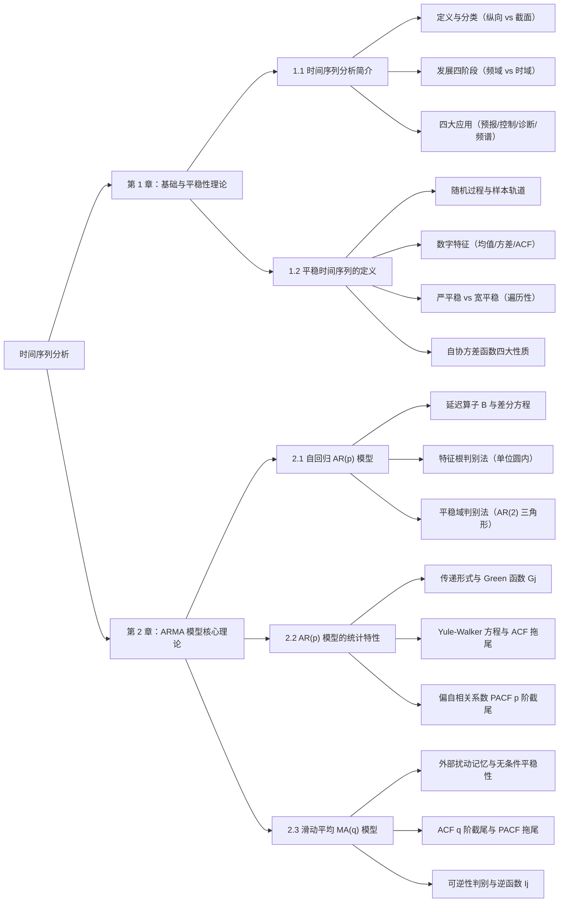

本系列整理自 **《时间序列分析》** 课程讲义、课堂推导板书与录音实录（参考教材：王燕《应用时间序列分析》、易丹辉《应用时间序列分析》）。内容涵盖时间序列的概率统计基础、平稳性理论、自回归模型 $\text{AR}(p)$、滑动平均模型 $\text{MA}(q)$ 及其核心统计特性与对偶关系。

**系列特色**：不仅收录了课件中的标准定义与定理，还完整还原了**课堂板书推导细节**（如条件期望消去法推导偏自相关系数 $\phi_{kk}$、时间轴重叠项法推导 $\text{MA}(q)$ 自协方差）、**考题高频避坑指南**以及配套 **Python (`statsmodels`) 仿真代码**。

---

## 知识体系全景导图

---

## 章节目录与核心速览

| 章节 | 标题 | 核心知识点与课堂精要 |
| :--- | :--- | :--- |
| **第 1 章 第 1 节** | [时间序列分析简介](01_intro.md) | 尼罗河泛滥历史起源、随机过程的一次样本实现、与传统 i.i.d. 统计分析的三大差异、时域/频域发展脉络、四大应用场景 |
| **第 1 章 第 2 节** | [平稳时间序列与自协方差函数](02_stationarity.md) | 均值/方差/自协方差 $\gamma(t,s)$/ACF、严平稳与宽平稳辩证关系（柯西反例与正态等价）、零均值白噪声 $\text{WN}(0,\sigma^2)$、遍历性、自协方差函数四大性质及证明 |
| **第 2 章 第 1 节** | [自回归 AR 模型与平稳性判别](03_ar_model.md) | Galton 回归思想、$\text{AR}(p)$ 定义、延迟算子 $B$ 与特征多项式 $\Phi(B)$、特征根 $\lambda_i$ 与多项式根 $b_i$ 互为倒数定理、特征根判别法与 $\text{AR}(2)$ 三角形平稳域 |
| **第 2 章 第 2 节** | [AR 模型的统计特性（Green 函数、ACF 与 PACF）](04_ar_properties.md) | 中心化变换、Green 函数 $G_j$ 递推与物理意义、自协方差递推算式、ACF 指数衰减四形态与**拖尾性**、PACF $\phi_{kk}$ 条件期望推导与 **$p$ 阶截尾性**、课堂综合大题精解 |
| **第 2 章 第 3 节** | [滑动平均 MA 模型、统计特性与可逆性](05_ma_model.md) | 外部冲击建模背景、$\text{MA}(q)$ 统计特性（无条件平稳、时间轴重叠法求 $\gamma_k$）、ACF **$q$ 阶截尾**与 PACF **拖尾**、ACF 非唯一性困境、**可逆性（Invertibility）**与逆函数、$\text{AR} \leftrightarrow \text{MA}$ 终极对偶表 |

/// table-caption
时间序列分析系列文章导航表
///

---

## 核心符号约定速查

!!! info "全系列通用数学记号约定"
    - **时间序列 / 随机过程**：$\{X_t, t \in T\}$ 或 $\{x_t\}$，其中 $\{\varepsilon_t\} \sim \text{WN}(0, \sigma^2)$ 表示零均值、方差为 $\sigma^2$ 的白噪声序列。
    - **延迟算子（Backshift Operator）**：$B x_t = x_{t-1}$，$B^k x_t = x_{t-k}$；一阶差分算子 $\nabla = 1 - B$。
    - **自回归系数多项式**：$\Phi(B) = 1 - \varphi_1 B - \varphi_2 B^2 - \cdots - \varphi_p B^p$，对应 $\text{AR}(p)$ 模型 $\Phi(B)x_t = \varepsilon_t$。
    - **滑动平均系数多项式**：$\Theta(B) = 1 - \theta_1 B - \theta_2 B^2 - \cdots - \theta_q B^q$，对应 $\text{MA}(q)$ 模型 $x_t = \Theta(B)\varepsilon_t$。
    - **数字特征**：均值 $\mu = E(x_t)$，方差 $\gamma_0 = D(x_t)$，延迟 $k$ 阶自协方差 $\gamma_k = \operatorname{Cov}(x_t, x_{t-k})$，延迟 $k$ 阶自相关系数（ACF）$\rho_k = \gamma_k / \gamma_0$，延迟 $k$ 阶偏自相关系数（PACF）记为 $\phi_{kk}$。

